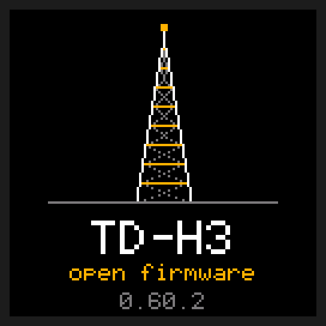

# td-h3-fw

**[Manual](https://github.com/limehawk/td-h3-fw/wiki)** · [Quick reference](https://github.com/limehawk/td-h3-fw/wiki#quick-reference) · [Download](https://github.com/limehawk/td-h3-fw/releases/latest) · [Updating](https://github.com/limehawk/td-h3-fw/wiki/Updating)

Open firmware for the TIDRADIO TD-H3 dual-band handheld (VHF/UHF, BK4819). It turns a cheap radio
into one that works like the big Icom, Yaesu and Kenwood handhelds: a clear dual-slot screen, fast
scanning that stops on what matters, weather radio and alerts, and transmit only where you allow
it. About 53 KB of C (62 KB available); your channels, CHIRP and the factory calibration keep
working.

> [!TIP]
> **The manual is in the [wiki](https://github.com/limehawk/td-h3-fw/wiki).** How to use the radio, flash it and load channels,
> written for people new to radios. Its front page is a one-page
> [quick reference](https://github.com/limehawk/td-h3-fw/wiki#quick-reference).

**For the TD-H3 only, not the TD-H3 Plus.** The Plus is a different radio inside (a different chip, updated a different way), so this firmware can't run on it, and the flasher won't find it.



## Put it on your radio

1. **Download the flasher for your computer.** It's the only file you need: the firmware is inside it.

   | Computer | Download |
   |---|---|
   | Windows | [tdh3-windows.exe](https://github.com/limehawk/td-h3-fw/releases/latest/download/tdh3-windows.exe) |
   | Mac with an Apple chip (M1 or newer) | [tdh3-macos-apple.zip](https://github.com/limehawk/td-h3-fw/releases/latest/download/tdh3-macos-apple.zip) |
   | Mac with an Intel chip | [tdh3-macos-intel.zip](https://github.com/limehawk/td-h3-fw/releases/latest/download/tdh3-macos-intel.zip) |
   | Linux | [tdh3-linux-x64](https://github.com/limehawk/td-h3-fw/releases/latest/download/tdh3-linux-x64) |
   | Raspberry Pi (64-bit Raspberry Pi OS) | [tdh3-linux-arm64](https://github.com/limehawk/td-h3-fw/releases/latest/download/tdh3-linux-arm64) |

2. **Plug the radio into the computer** with a USB-C cable that carries data (a charge-only cable won't do).
3. **Open the flasher.**
   - Windows: double-click it. If Windows says it protected your PC, click **More info**, then **Run anyway**.
   - Mac: double-click the zip (Safari may have unzipped it already), then double-click the flasher.
     The first time, the Mac won't open it: go to **System Settings**, **Privacy & Security**, scroll
     down, click **Open Anyway** and confirm with your password, then open the flasher again.
   - Linux or Raspberry Pi: in a terminal, `cd ~/Downloads`, `chmod +x tdh3-linux-*`, then
     `./tdh3-linux-x64` (or `-arm64`).
4. **Do what it says.** Hold **PTT** (the big key on the side) when it tells you to. The first time, it asks you to switch the radio off, hold **PTT**, and switch it
   back on.

It takes about a minute, and your channels and settings stay. Next time, `tdh3 update` in a terminal
fetches the newest flasher, checks its signature and flashes it. Something not working, or want to go
back to TIDRADIO's firmware? [Updating the firmware](https://github.com/limehawk/td-h3-fw/wiki/Updating).

This is not TIDRADIO's firmware and TIDRADIO has nothing to do with it. Flashing it is at your own
risk; the stock firmware can always be put back. Transmitting needs the licence the band asks for
(an amateur licence for 2 m and 70 cm, a GMRS licence for GMRS), and you're the one responsible
for what the radio sends.

## Run it from your computer, or let an AI set it up

Switch on REMOTE (**MENU**, **4** **5**, **MENU**, **UP**, **MENU**, then **V/M**) and the flasher you downloaded also works the radio
over the same USB-C cable: it reads the screen as text, presses keys, tunes, picks channels and
lists every setting. That's all an AI assistant that can run commands on your
computer (Claude Code, Codex and the like) needs to set the radio up for you: *"put slot B on the
weather channel and tell me how strong it is"*, *"what are my squelch and battery saver set to?"*.
It can never make the radio transmit: the radio refuses PTT from the cable, whatever the computer
sends.

```bash
tdh3 remote screen                  # what the radio shows, as text (-o shot.png for a picture)
tdh3 remote tune 146.520            # tune the selected slot
tdh3 remote settings                # every menu setting and its value
tdh3 remote wait "squelch open"     # returns when someone talks on the frequency
```

For these, put the radio in PC LINK instead (**MENU**, **4** **4**, **MENU**); **V/M** leaves it:

```bash
tdh3 channels import channels.csv   # load a channel list saved from CHIRP
tdh3 eeprom backup my-radio.bin     # save the radio's memory: channels and settings
tdh3 settings restore my-radio.bin  # put the settings from that backup back
tdh3 reset                          # every setting back to its default (the channels stay)
```

(`tdh3` is the flasher you downloaded: `.\tdh3-windows.exe`, `./tdh3-macos-apple`, ...) What it
can do and what to tell your assistant: [docs/AI-AGENTS.md](docs/AI-AGENTS.md).

## What it does

**Listening**
- 18-999 MHz, AM picked automatically on the air band, FM wide or narrow everywhere else, AM or USB (SSB receive, 10 Hz tuning) by choice.
- Two slots, A and B, each a frequency or one of the radio's 199 memory channels, with a signal
  meter that points at the slot it reads, S-units and all.
- Squelch 0-9, or by S-meter (S1-S9) like Icom's; CTCSS and DCS tones, with a tone finder that
  copies the tone a station uses. No squelch-tail noise burst when other radios unkey.
- Attenuator for strong nearby stations, and an AM fix that steps the gain down so strong airband signals don't distort.
- Dual watch and a priority channel, holding a station through fades.
- Touch-tone (DTMF) digits shown when someone sends a run of them.

**Scanning**
- Memory scan over the scan list or one of 8 groups; a group also works as a bank for UP/DOWN.
- Frequency scan inside the band you start in (2 m, 70 cm, GMRS, air, marine, weather).
- Icom-style pause and resume timers, a carrier check so it stops on real signals, and skip for
  nuisance channels.

**Weather**
- Weather mode: NOAA WX1-WX7 on one key, strongest first.
- Weather alert: listens for the 1050 Hz alarm tone in the background, even from the FM radio.

**Transmitting** (the full build only)
- Only on the services you switch on in TX BANDS: ham 2 m and 70 cm, GMRS, MURS, FRS. Never air
  band, marine or government frequencies, and never without the radio's factory power calibration.
- Automatic repeater shift from the US band plan, TX timeout with a warning, busy-channel lockout,
  per-channel TX lock, tail tone, VOX, touch-tone (DTMF) sending with stored codes.

**Everything else**
- FM broadcast radio with seek and presets; a spectrum scope; freq find (grab a nearby
  transmitter's frequency).
- Flashlight with one-button controls like Olight's: moonlight to high, strobe, SOS.
- Keypad lock, themes (night red keeps your night vision), battery saver, auto power-off.
- PC LINK for CHIRP and the `tdh3` tool (USB or Bluetooth), and REMOTE: a computer, or an AI agent,
  can see the screen and press keys over USB. Neither can make the radio transmit.

Left out on purpose: scrambler, DTMF paging and remote kill, voice prompts, LSB.

## For developers

- [docs/DEVELOPING.md](docs/DEVELOPING.md): build, test, flash, the rules for driving the real radio.
- [docs/HARDWARE.md](docs/HARDWARE.md): pins, chips and registers, and where each fact came from.
- [docs/AI-AGENTS.md](docs/AI-AGENTS.md): letting an AI agent use the radio through `tdh3`.
- [docs/PORTING.md](docs/PORTING.md): other TD-H3 variants and other radios.

```bash
make -C fw all rxonly    # SDCC 4.5 in .toolchain/; fails if an image would reach the bootloader
make -C fw test          # the real firmware in an 8051 emulator, about 90 tests
cd tools/tdh3 && go build && go test ./...   # tdh3: flash, update, backup, channels, settings, remote
```

`docs/manual/` is the wiki's source: `make -C fw wiki` publishes it.

## Credits

With thanks to the people whose work this firmware stands on:

- **TIDRADIO**: the register values for the BK4819, RDA5807M and the LCD were read out of the
  TD-H3's stock firmware (sources in [docs/HARDWARE.md](docs/HARDWARE.md)). TIDRADIO's images
  aren't included: `stock/README.md` lists where to download them.
- **nicsure**, whose TD-H3-Engineering notes documented this radio: the pin map from TIDRADIO's
  schematic, the clone and bootloader protocols, TIDRADIO's EEPROM map, and the stock bootloader
  read off a radio. ULTRA LOW power is nicsure's Ultra Low Power idea (no TX bias). This firmware
  uses those facts and that idea; it contains no code from nicsure's notes, flasher (TDH3Flash) or
  firmware (nicFW).
- **CHIRP**: its `tdh8.py` driver documents the clone protocol and memory layout, checked here
  against the stock firmware. No CHIRP code.
- **DualTachyon** (uv-k5-firmware), **Armel / F4HWN** (uv-k5-firmware-custom, and with muzkr the
  UV-K1 / UV-K5 V3 port), **OneOfEleven** (am_fix.c) and **fagci** (spectrum.c): how the BK4819 is
  driven, from tone scan, the frequency counter and the tone generator to squelch, AGC, SSB receive
  and the scope's RSSI read. A few register set-ups, gain tables and that RSSI read are adapted from
  their Apache-2.0 code: [NOTICE](NOTICE) lists each one, and `fw/bk4819.c` carries their notices.
- The Beken BK4819 datasheet, and TIA-603 for the DCS encoder.

## Licence

MIT, see [LICENSE](LICENSE), except the Apache-2.0 parts of `fw/bk4819.c` named above: their
notices are at the top of that file, the licence is in [LICENSE-APACHE](LICENSE-APACHE), and what
came from where is in [NOTICE](NOTICE). The text font (Adafruit GFX glcdfont, digits from the
public-domain Pixel Operator) and the icons (Open Iconic) carry their own licences:
[docs/FONTS.md](docs/FONTS.md).

TIDRADIO and TD-H3 are trademarks of their owner, and other product names belong to theirs. This
project isn't affiliated with or endorsed by TIDRADIO or any project named above.
