# Channels and scanning

## Quick reference

| I want to… | Press |
|---|---|
| Start scanning | **\*** in memory mode (if the slot shows `VFO`, press **V/M** first) |
| Stop scanning | **\***: stays on the station it's on, goes to the one it found, or lists what it found to pick from (**UP**/**DOWN**, **MENU**); found nothing: back where you started |
| Stop scanning and go back where you started | **V/M** |
| Skip to the next channel while scanning | **UP** |
| Scan downward instead (or back one channel) | **DOWN**; **UP** scans upward again |
| Skip a noisy channel from now on | Hold **V/M** while scanning |
| Scan one group only | While scanning your channels (memory mode), **1**-**8**; **0** for the whole scan list |
| Put this channel on or off the scan list (un-skip it) | Hold **V/M** (memory mode, not scanning) |
| Save this frequency as a channel | Hold **MENU**, then **MENU** (yes) or **V/M** (no). While scanning, it stops as **\*** does and offers to save that channel |
| Name, delete or copy a channel | **MENU**, **3** **2** (CH NAME), **3** **4** (DELETE CH) or **3** **3** (CH TO VFO), then **MENU** |
| Listen to NOAA weather | Hold **#**; hold **#** again to go back |
| Copy channels from another radio | `tdh3 eeprom backup` on that one, then `tdh3 channels copy FILE` on this one ([below](#copy-channels-from-another-radio)) |
| See, change, move or empty channels from the computer | PC LINK, then `tdh3 channels list`, `set`, `move`, `clear` ([below](#changing-channels-from-the-computer)) |

The radio stores up to 199 **memory channels**, each a frequency with its name, tones and power.
Press **V/M** to switch a slot between frequency mode (VFO, type any frequency) and memory mode
(step through your channels).

## Loading your channel list

The easiest way is from a computer with [CHIRP](https://chirp.danplanet.com) or `tdh3`, the flasher you
downloaded ([Updating the firmware](Updating#get-the-flasher); type `.\tdh3.exe` on Windows and
`./tdh3` on a Mac or Linux where these steps say `tdh3`).

1. On the radio: **MENU**, then type **4** **4** to reach **PC LINK**, then **MENU**. The
   screen says *waiting for computer*. Plug in the USB-C cable. (With BLUETOOTH on in the menu, a
   phone app can talk to it over Bluetooth too.)

   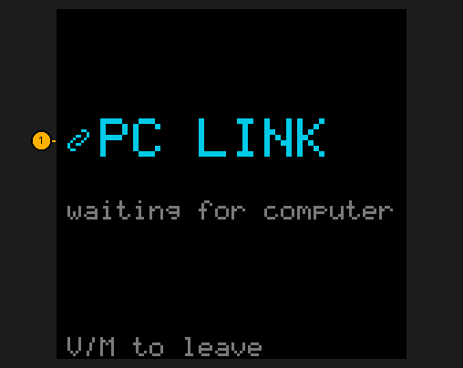

2. In CHIRP: choose *TIDRADIO TD-H3*, then *Radio → Download*, edit, *Radio → Upload*.
   Or from a CHIRP CSV file:
   ```bash
   tdh3 channels import mylist.csv
   ```
3. **V/M** leaves PC LINK. It stays open until you do, however long the cable or CHIRP takes.
   If the computer wrote the radio's settings (a CHIRP Upload can), the radio restarts by itself
   when the computer is done, so it starts on the new settings.

Your channels and settings are kept through firmware updates.

**Power** is stored the way TIDRADIO's own firmware stores it, so a channel set to High in CHIRP
transmits on high. To change a channel's power on the radio, go to the channel and hold **2**: each
hold steps low → mid → high → ultra-low, shows on the screen at once, and is saved with the channel.
CHIRP knows only Low and High, and shows MID and ULTRA LOW as Low. `tdh3 channels import` takes all
four in the Power column: `ULow`, `Low`, `Mid`, `High`, or a wattage, which picks the level at or
under it (0.5W ultra-low, 1.0W or 2.0W low, 3.0W mid, 5.0W high).

**Mode**: `tdh3 channels import` reads the CSV's Mode column: FM, NFM (narrow FM), AM, or USB for
[SSB](Home-Screen#listening-to-ssb). CHIRP's own Upload stores every channel as FM (the air band
stays AM), so import a USB channel with `tdh3`, or save it on the radio from a frequency set to
USB (MENU → MODE).

## Changing channels from the computer

`tdh3` (the flasher you downloaded) can show and change your channels one at a time, or many at
once. Put the radio in PC LINK first: **MENU**, type **4** **4**, **MENU**. **V/M** leaves it when you're done.

| I want to… | Type |
|---|---|
| See my channels | `tdh3 channels list` (just some: `--slots 1-20,84`) |
| Save them to a file I can edit | `tdh3 channels export my-channels.csv` |
| Load that file back | `tdh3 channels import my-channels.csv` |
| Lower the power on some channels | `tdh3 channels set 88-94 --power ulow` |
| Rename a channel | `tdh3 channels set 11 --name "HOME RPT"` |
| Change its tone | `tdh3 channels set 11 --tone 100.0` (`--rx-tone`, `--tx-tone` for one way; DCS is `D023N`; `off` removes it) |
| Change its shift | `tdh3 channels set 11 --duplex - --offset 0.6` (or `--duplex simplex`) |
| Change its frequency | `tdh3 channels set 11 --rx 145.470` (its shift stays) |
| Narrow or wide | `tdh3 channels set 88-94 --bw narrow` |
| Put channels in scan groups | `tdh3 channels set 1-39 --groups 1,3` (`none` empties them) |
| Take channels off the scan list | `tdh3 channels set 115-121 --scan off` |
| Move a channel to an empty number | `tdh3 channels move 111 150` |
| Empty channels | `tdh3 channels clear 66` |
| Stop a channel ever transmitting | `tdh3 channels lock 132` (`unlock` makes it simplex again) |

Channel numbers can be a list and ranges, like `1-39,41,88-94`. Only what you ask for changes; everything
else about a channel stays. Before changing anything `tdh3` saves the radio's whole memory to a dated
file in `backups/`, and it reads back what it wrote. If one channel in the list is empty or a value is
wrong, it says so and changes nothing at all. `list` and `export` also read a backup file: add
`--file my-radio-backup.bin`, no radio needed.

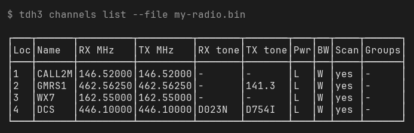

Power is `ulow`, `low`, `mid`, `high`, or watts like `5W`.

## Copy channels from another radio

Puts the channel list of one TD-H3 (radio 1) on another (radio 2): every channel with its name,
tones, power, scan list and scan groups, and the 25 FM radio presets. Radio 2 keeps its own
settings, its calibration and everything else. Its old channels 1-199 are replaced.

You need one USB-C cable. Run the commands in the firmware's folder.

1. **Save radio 1's memory to a file.** Plug radio 1 in. On it: **MENU**, type **4** **4** (PC LINK),
   **MENU**. The screen says *waiting for computer*. On the computer:
   ```bash
   tdh3 eeprom backup radio1.bin
   ```
   It finds the cable by itself (with two radio cables plugged in, name one: `-p /dev/ttyUSB0`).
   When it says *saved*, press **V/M** on radio 1 and unplug it.
2. **Plug radio 2 in** and put it in PC LINK the same way: **MENU**, **4** **4** (PC LINK), **MENU**.
3. **Copy:**
   ```bash
   tdh3 channels copy radio1.bin
   ```
   It shows how many channels radio1.bin holds and the first few names, what it will write and
   what it keeps, then waits. Check it's the list you expect and press **Enter**
   (if it says *no answer*, radio 2 isn't in PC LINK: do step 2
   again and rerun).
4. It saves radio 2's whole memory first, to `backups/td-h3-` plus the date and time `.bin`, then
   writes the channels and reads them back to check every byte. The last line says
   *N channels copied and checked*. Press **V/M** on radio 2: its channels are there.

To keep radio 2's own FM presets, add `--fm=false`:
`tdh3 channels copy --fm=false radio1.bin`.

If it stops with an error part-way, run the same command again. The backup it saved in step 4
holds radio 2 as it was before.

## Scan groups

Group channels so you can scan just the ones you care about: repeaters, GMRS, weather and so on.

- In the CHIRP CSV, put `G1` to `G8` in a channel's **Comment** (`G1 G3` for two groups).
  `LISTA 1` style comments, as other radios write their scan lists, work too.
- Then load it with `tdh3 channels import`. (CHIRP's own Upload clears the groups, so import the
  CSV after any CHIRP upload. An import turns busy lockout off on the channels it writes, and
  channels on the radio that aren't in the file stay as they are; `--clear` empties those.)
- **Or on the radio:** go to the channel in memory mode, then **MENU**, type **2** **6** (CH GROUPS),
  **MENU**. Move with **UP/DOWN**, **MENU** puts the lit group on or off for this channel
  (`[*]` = in it), **V/M** goes back and saves your changes (a short chime).

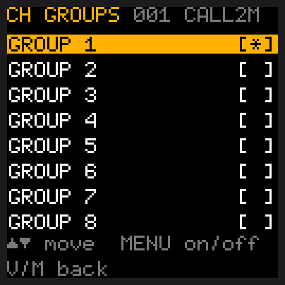

Pick a group under **MENU → SCAN GROUP** and it works like a bank on the big rigs: in memory mode
**UP** and **DOWN** step only through that group's channels, and a scan covers just that group. To
scan several groups at once, use **MENU → GROUP LINK** (item 25) instead and put each one on. With
SCAN GROUP on **SCAN LIST**, UP and DOWN step through all your channels. A group scan, like every
scan, passes channels that are off the scan list (no `*`). A group with no channels to scan says
**GROUP IS EMPTY**.

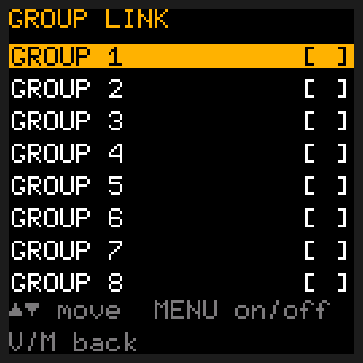

## Scanning

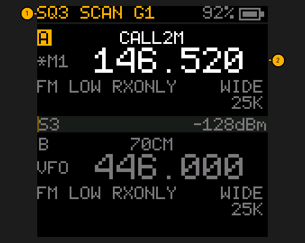

1. **The status bar at the top shows what's being scanned**: `SCAN G1` for group 1, plain `SCAN` for the
   whole scan list.
2. **Start**: in memory mode (if the slot shows `VFO`, press **V/M** first), press **\***. It stops on any active channel and
   moves on when it goes quiet. It scans upward; **DOWN** turns it around to scan downward, **UP**
   back upward, and either moves on at once.
3. **Stop** with **\*** or **V/M** (below).

**Where a scan stops.** The radio remembers where the scan started, and every station it stopped
on while it ran: they go to the top of [Last heard](Tools#last-heard), newest first. Press **\*** to
stop:

- **On a station right now** (you hear it, or it went quiet a moment ago and the scan is waiting
  for the reply): it stays there.
- **Found nothing**: back to the channel or frequency where you started.
- **Found one station**: it goes to that station.
- **Found two or more**: the **LAST HEARD** list opens with the newest one lit. **UP**/**DOWN**
  picks one, **MENU** goes there, **V/M** goes back to where you started.

**V/M** always stops and goes back to where you started, even on a station.

**When it moves on**, as on the big desk rigs: it stays on a busy channel for as long as someone
is talking, however long. When they let go, it waits **SCAN RESUME** (5 s by default) so you hear the
reply; if anyone talks again in that time it stays, and after 5 s of quiet it moves on. Don't want
to wait? **UP** or **DOWN** skips to the next or previous channel at once and keeps scanning that way.

**SCAN PAUSE** sets a time limit on one channel (2, 5, 10 or 20 s) for stations that never stop,
like NOAA weather; **BUSY** (the default) means no limit. RESUME HOLD stays the whole pause time on
a station, even when it goes quiet in between; with SCAN PAUSE on BUSY, RESUME HOLD stops the scan on
the first station it finds. A group with a single channel just listens to it.
On a channel with an RX tone, a signal gets up to 0.4 s for its tone to be recognised before the
scan moves on.

**Skipping a channel for good**, as Kenwood's lockout does: a channel that's always busy with
something you don't want (a data burst, a noisy neighbour)? Hold **V/M** while the scan is on it.
It says `CHANNEL SKIPPED`, moves on, and takes the channel off the scan list, so its `*` goes and
no scan stops there again, group scans included, even after you switch off. You can still go to it
with UP/DOWN or by typing its number. To put it back: go to it (not scanning) and hold **V/M**; its
`*` comes back. CHIRP shows the same thing as **Skip: S**. In frequency mode there's no channel to
mark: hold **V/M** skips that frequency until you switch off (the last 8 are kept).

While scanning your channels (memory mode), tap **1-8** to jump to another group, or **0** for the whole scan list. A group
with no channels says **GROUP IS EMPTY** and keeps scanning where it was. With no channels on the
scan list at all, **\*** says **SCAN LIST EMPTY** (**GROUP IS EMPTY** with a SCAN GROUP picked) and doesn't start.

Holding **MENU** (save), **3** (scope), **7** (freq find), **8** (FM) or **#** (weather) stops the
scan first, the way **\*** does (with two or more stations found, you pick one from the list
first); holding **\*** (lock) and **PTT** stop it where it is. Dual watch rests while a scan runs;
priority keeps being checked.

In frequency mode, **\*** scans up through the band you start in instead (2 m, 70 cm, GMRS, air,
marine, weather), using the tuning step. Started outside those bands, it scans between the A and B
frequencies when the other slot is also in frequency mode on the same side of 300 MHz (put A at one
end and B at the other), and otherwise 1 MHz either side of where it started.

The scan won't start with the squelch open (SQUELCH 0, or monitor on): it would stop on every
channel. It says **SQUELCH IS OPEN**; turn the monitor off (hold **1**) or raise SQUELCH first.

## Weather

In the US, NOAA Weather Radio broadcasts the forecast and warnings all day on seven channels,
WX1 to WX7 (162.400 to 162.550 MHz). One or two of them reach most places.

1. **Hold #** (or **MENU** → **WEATHER** → **MENU**). The selected slot shows `WX3` (or whichever), with
   `WX` lit where the channel number usually is, and
   plays the strongest weather channel the radio can hear: each time, it checks all seven first
   and picks the best. Dual watch and priority pause while you're on a weather channel.
2. **UP / DOWN** changes channel, WX1 to WX7.
3. **Hold #** again to go back. The slot is exactly as you left it.

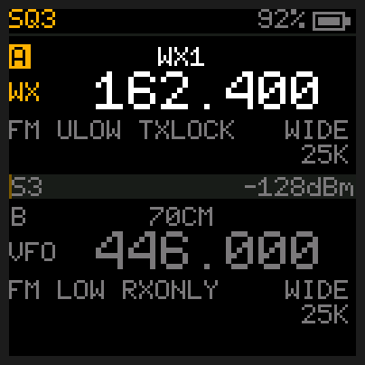

Typing a frequency, **V/M**, **\*** (scan) and **#** (A/B) also leave weather mode first, then do
their usual job, and so does PTT or side key 1 on the other slot. You can't transmit on a weather
channel (`TX LOCKED CHANNEL`). If **WX ALERT** is on (see [Tools](Tools#weather-alert)), it switches
to the channel you're listening to; turn WX ALERT OFF in the menu and it stays off. While you're in
weather mode the alert alarm sounds too, once for each alert, and you hear the broadcast under it.
Weather mode ends when the radio is switched off.

## Saving a frequency as a channel

Hold **MENU**. The radio suggests the first free channel (`SAVE CH 005? MENU=YES`); press MENU to
save there, type another number first, or press **V/M** not to save. It says `SAVED CH 005` with
two rising notes. With all 199 channels in use you hear the "not possible" sound instead. Left
alone for 20 seconds, the question goes away without saving. The channel is named after its frequency; to give it a name
of your own, see [Naming a channel](#naming-a-channel).

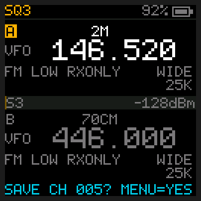

If the number you typed already holds a channel, the radio warns you first: the bottom line turns
red and asks `REPLACE 005? MENU=YES`. Press **MENU** again to write over it, or **V/M** to leave it
as it was. Typing another number instead starts over.

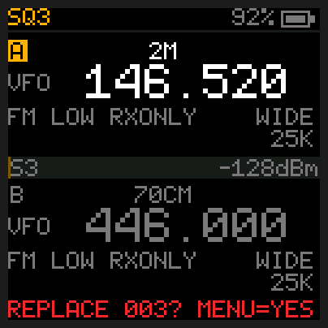

## Deleting a channel

To empty a memory channel you no longer want, right on the radio:

1. **MENU**, type **3** **4** (DELETE CH), then **MENU**. The screen lists your channels: number,
   name and frequency (`002 GMRS1    462.562`). The lit one is the channel the selected slot is on,
   or your first channel if the slot is in frequency mode.
2. **UP / DOWN** to light the channel to delete.
3. **MENU**: the row turns red and the radio asks `DELETE 002 GMRS1?`. Nothing is deleted yet.
   **MENU** again (YES) deletes it, with a short chime. **V/M** (NO) leaves it as it was.
4. The list stays up on the next channel, so you can delete more. **V/M** goes back to the menu.

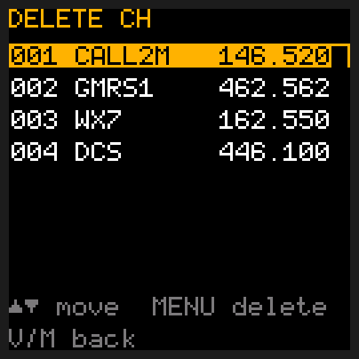 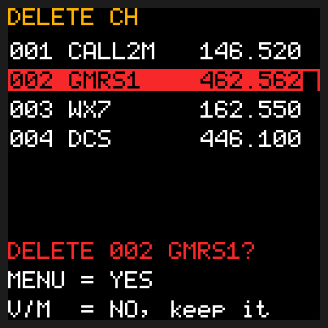

The channel is emptied the same way CHIRP empties one, so CHIRP and the radio both show it as
empty. UP and DOWN in memory mode skip it from then on. A slot that was on it goes to frequency
mode, and a PRIORITY channel that was deleted turns PRIORITY off.

## Copying a channel to frequency mode

Bigger radios call this "MR to VFO". It copies a memory channel into frequency mode, so you can
tune up and down from it, or change its tone, without touching the channel itself.

1. Go to the channel in memory mode (the slot shows `M` and the channel number, `*M` when it's on the scan list).
2. **MENU**, type **3** **3** (CH TO VFO), then **MENU**.

The slot switches to frequency mode on the channel's frequency, and the frequency-mode settings
(RX TONE, TX TONE, SHIFT, OFFSET, BANDWIDTH, POWER) take the channel's values. The channel stays as
it was; **V/M** goes back to it. A channel whose transmit frequency is an unusual distance from its
receive frequency (more than 12.75 MHz, or not a multiple of 0.05 MHz) comes over
with SHIFT OFF: set SHIFT and OFFSET yourself before you talk through that repeater.

## Naming a channel

A channel's name (up to 8 letters, numbers or spaces) shows on the home screen above its
frequency. To change it on the radio:

1. Go to the channel in memory mode (the slot shows `M` and the channel number, `*M` when it's on the scan list).
2. **MENU**, type **3** **2** (CH NAME), then **MENU**. The name shows large, with a line under the
   letter you are on.

   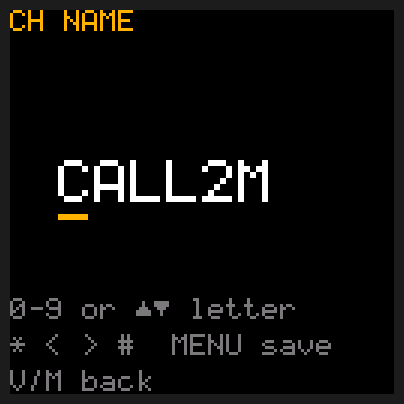

3. Type the new name the way you would text on an old phone. Each number key has letters on it:

   | Key | Gives, one press after another |
   |---|---|
   | 2 | A B C 2 |
   | 3 | D E F 3 |
   | 4 | G H I 4 |
   | 5 | J K L 5 |
   | 6 | M N O 6 |
   | 7 | P Q R S 7 |
   | 8 | T U V 8 |
   | 9 | W X Y Z 9 |
   | 0 | space, 0 |
   | 1 | - / . 1 |

   Press a key again within a second to get its next letter: **4** **4** is H. The next key you
   press goes in the next place; for two letters from the same key, wait a second between them. So
   `HI` is **4** **4**, wait, **4** **4** **4**. You type over the old name from its first letter:
   letters past the end of your new one stay, so press **0** (a space) over each of them; spaces
   at the end are dropped.
   Or step through the letters with **UP / DOWN**: **UP** turns an A into a B, **DOWN** back again.
4. **\*** moves the line one letter left and **#** one letter right (where they sit on the
   keypad), to fix a mistake: type over it. A space at the end of the name is dropped.
5. **MENU** saves the name (a short chime) and goes back to the menu. **V/M** goes back without
   saving.

Only the name is changed; the channel's frequency, tones and groups stay as they were. CHIRP reads
the new name the next time it downloads from the radio.
