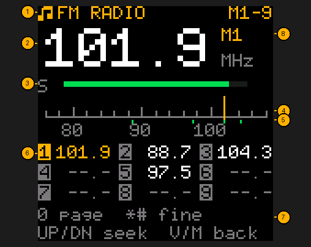
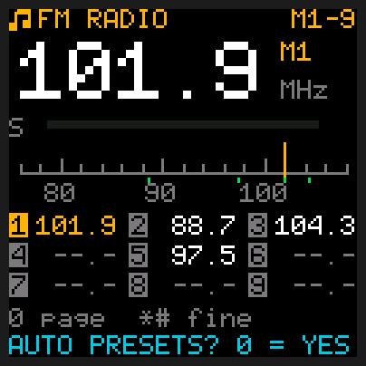

# FM radio

## Quick reference

| I want to… | Press |
|---|---|
| Turn the FM radio on | Hold **8** |
| Leave it | **V/M** (or **PTT** or **side key 1**, which go on to transmit on slot A or B while held) |
| Find the next / previous station | **UP** / **DOWN** |
| Nudge up / down 0.1 MHz | **\*** / **#** |
| Play a preset | **1**-**9** (**0** turns the page: M1-9, M10-18, M19-25) |
| Save this station as a preset | Hold **1**-**9** |
| Go to a frequency | **MENU**, type it: `1035` = 103.5 goes at once; `885` then **MENU** = 88.5 |
| Fill the presets for me | Hold **0**, then **0** |

Hold **8** to listen to FM broadcast stations (76-108 MHz). V/M goes back to the radio. Switched
off while listening, it comes back on the radio's home screen.
The screen goes dark after the LIGHT time, as on the home screen (the first key then only lights
it), and side key 2 works the flashlight here too.

1. **FM RADIO**: you're in broadcast mode; the two-way radio is off while you listen. If WX ALERT
   is on, it still checks your weather channel every 5 seconds; when it hears the alert tone the FM
   radio closes and the [weather alert](Tools#weather-alert) sounds.
2. **The station**, in MHz.
3. **Signal bar**: how far this station stands above the band's background noise.
4. **The dial**: the whole band, 76 to 108 MHz. The amber needle is where you're tuned.
5. **Preset dots**: a green dot for each saved preset (all 25), so you can see where they sit.
6. **Presets**, saved stations, nine at a time. The grey boxes are the keys 1-9, laid out like
   the keypad: press the key in the box to play the station beside it. The one you're on is lit
   amber; `--.-` is an empty slot. Top right says which slots this page holds: **M1-9**, **M10-18**
   or **M19-25** (press **0** for the next page).
7. **Keys** reminder: **0** turns the page, **\*** / **#** fine tune, **UP** / **DOWN** seek, **V/M** goes back to the two-way radio.
8. **The slot** you're playing, M1 to M25 (blank if this station isn't saved).

| Key | Does |
|---|---|
| **UP / DOWN** | Seek to the next / previous station |
| **\* / #** | Fine tune up / down 0.1 MHz |
| **1-9** | Go to that preset (an empty one says `EMPTY: HOLD TO SAVE`) |
| hold **1-9** | Save the station you're on to that preset (`SAVED M3`). Held on that preset's own station, it clears it (`CLEARED M3`). |
| **0** | Next page of presets: M1-9, then M10-18, then M19-25, then M1-9 again |
| hold **0**, then **0** | Find the stations for you and save them as presets (below) |
| **MENU**, then digits | Type a frequency, 76.0-108.0 MHz: four digits tune at once (`1035` = 103.5), three need **MENU** (`885` MENU = 88.5). **V/M** deletes a digit, or with none typed stops typing. A frequency outside the band is ignored. |
| **V/M** | Back to the two-way radio |

**Presets** are stored where TIDRADIO's own firmware keeps them, so CHIRP can see and edit them
(CHIRP calls them FM Channel 1-25). There are 25, on three pages of nine keys: tap **0** to turn
the page. On the M10-18 page, the box with **1** is slot M10, **2** is M11 and so on; on M19-25,
keys **1**-**7** are M19-M25 and **8** and **9** just give the "not possible" sound.

**Automatic presets:** hold **0** and the screen asks `AUTO PRESETS? 0 = YES`. Press **0** to go
ahead; any other key leaves your presets alone. The radio then sweeps the band three times (the
needle moves along the dial; `PASS 2/3 FOUND 14` says which sweep it's on and how many stations it
has heard so far). A station only counts if it comes in on all three sweeps, so a burst of noise
or a station that fades in and out is left out, and so is the "spill" a strong station makes on
the channel right next to it. It keeps the 25 that came in best and saves them as presets 1-25
(M1-M25), lowest frequency first. **This replaces all your presets**; any it doesn't fill are
emptied. When it's done it says how many it saved (`SAVED 12`) and plays M1. It takes a few
seconds. Press any key while it's sweeping to stop it: your old presets stay as they were. If it
finds nothing (`NO STATIONS FOUND`) your presets aren't changed either.

**About seek:** this radio's FM chip can't report signal strength back to the processor, so seek
(and the automatic presets) listen with the main radio chip instead. It's less sensitive than the FM chip, so seek finds the
stronger stations; for a weak one you can hear fine, tune to it with \* / # and save it as a preset.
It steps the US broadcast channels (88.1 to 107.9 MHz, odd tenths); fine tune reaches everything.
There's no station name display (RDS) for the same reason.
