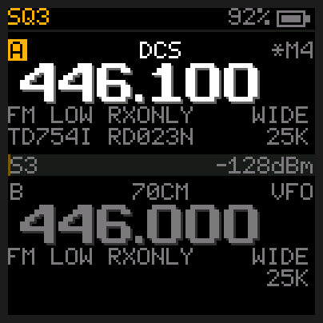
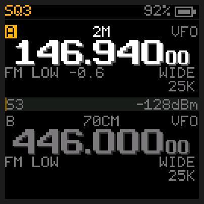
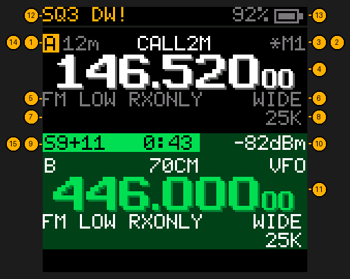
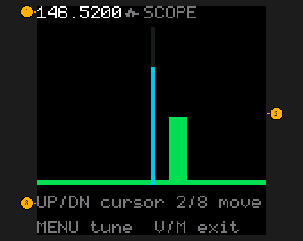

# Glossary

**AM**: amplitude modulation. Used by aircraft (108-137 MHz); the radio switches to it there, with a
wider filter and brighter sound than FM, and turns its own gain down in steps on loud stations (near
an airport) so they don't distort.

**Attenuator**: turns the receiver's gain down (about 10 dB) so a very strong nearby station doesn't
swamp weaker ones. MENU → ATTENUATOR; `ATT` in the status bar.

**SSB / USB**: single sideband, upper sideband. A way of sending voice with no carrier, only the
voice's upper half, so it reaches much farther than FM on the same power. Hams use it for
weak-signal work on 2 m (around 144.200 MHz) and 70 cm (around 432.100), and satellites send voice
and Morse code that way. MENU → MODE → USB; this radio only listens.

**Band**: a range of frequencies with one use: 2 m (144-148 MHz) and 70 cm (420-450 MHz) are ham
bands; GMRS is around 462/467 MHz; NOAA weather is 162.400-162.550 MHz.

**Busy lockout (BCL)**: a channel setting, made in CHIRP, that stops PTT while the channel is busy, so
you don't talk over someone (`BUSY: NO TX`).

**Channel / memory**: a stored frequency with its name, tones and power, numbered 1-199.

**CHIRP**: free programming software for many radios, used from a computer to edit the channel list.
The radio talks to it in PC LINK (item 45).

**Compander**: a pair of tricks that cut hiss on a weak signal: the sending radio squeezes loud and soft
parts of your voice closer together, and the receiving radio stretches them back out. It only works
when both radios have it on (MENU → COMPANDER).

**CTCSS**: a low, inaudible tone (67-254 Hz) sent with your voice. Repeaters often need one to
let you in, and with RX TONE set your radio stays quiet unless a station sends the right one.
Also called PL or "tone".

**dBm**: signal power measured against one milliwatt. Always negative here: -120 dBm is a whisper,
-60 dBm very strong.

**DCS**: the digital version of CTCSS: a code like `D023N` instead of a tone. `N`/`I` is normal
or inverted.

**DTMF**: touch-tone digits (0-9, A-D, `*`, `#`), the beeps a phone keypad makes. Repeaters and
nets use them for codes and remote control. The radio shows any it hears on the home screen, and sends
them while you hold PTT: see [Transmitting](Transmitting#touch-tones-dtmf).

**Dual watch**: listening to the selected slot while checking the other one every half second (hold **9**). `DW` in the status bar; `DW!` while you hear a call it caught.

**Flash mode**: the radio's built-in loader that takes new firmware over the cable. Its screen
stays dark. Reached by holding PTT while switching on, or by the flasher with REMOTE on.

**FM / narrow FM**: frequency modulation, how two-way voice is sent on VHF/UHF. Wide FM (`WIDE` on the
screen) is the norm for GMRS and most ham repeaters; narrow (`NARR`) uses half the width (a quarter with NARROW kHz at 6.25). FM *broadcast*
radio is the same idea, much wider, and needs the radio's separate FM chip.

**Freq find**: finds the frequency of a radio transmitting right next to yours (hold **7**).

**FRS / MURS**: US licence-free services: FRS on GMRS's 462/467 MHz channels at low power, MURS on five
channels around 151-154 MHz. The radio may transmit on them only if you switch them on in TX BANDS.

**GMRS**: General Mobile Radio Service, US channels around 462 and 467 MHz for families and
groups. Needs a licence (no exam).

**Ham / amateur radio**: licensed hobby radio. Needs an exam-based licence.

**Memory mode**: the slot steps through your stored channels (`M12` on the screen). **V/M**
switches between it and frequency mode (VFO).

**Monitor**: open the squelch on purpose to hear everything on a frequency, even faint signals
and noise.

**NOAA weather radio**: the US weather service's broadcasts on seven channels, 162.400-162.550 MHz
(WX1-WX7), with a 1050 Hz alert tone before warnings. Hold **#** to listen.

**Offset / shift**: a repeater listens on one frequency and transmits on another. The offset is
the gap (0.6 MHz on 2 m, 5 MHz on 70 cm and GMRS) and the shift (+/-) its direction. The radio
handles it: memory channels carry their own, and in frequency mode SHIFT AUTO picks it from the US band
plan. Outside the US, set SHIFT to + or - yourself; OFFSET keeps one gap for VHF and one for UHF (see the
[Menu](Menu)).

**Priority channel**: one channel the radio checks every 2 seconds whatever else it's doing (every 5 seconds while you're listening to a call).

**PTT**: push to talk, the big key on the side. Hold it to transmit, let go to listen.

**Repeater**: a powerful radio on a hill or tower that receives you and re-transmits you, so a
handheld reaches tens of miles instead of a few.

**Reverse**: listen on a repeater's input, to hear whether the other station is in direct range.

**Reverse burst**: the big brands' (Kenwood, Motorola) way of ending a call on a CTCSS channel: the
tone is flipped back to front for a moment as you let go of PTT, and a radio that knows it shuts its
speaker before the noise. TAIL TONE → REVERSE sends it; see Tail tone for the usual 55 Hz way.

**S-meter / S-units**: signal strength, S0 (nothing) to S9 (strong); beyond that in dB over S9 (`S9+20`).

**Scan list / scan group**: the channels a scan visits. `*` next to a channel number means it's
on the scan list; groups 1-8 are your own subsets. A channel off the scan list is *skipped*: no
scan stops on it, group scans included (hold **V/M** while scanning).

**Scope (spectrum)**: a picture of the signals on the frequencies around you, as bars (hold **3**).

**Simplex**: talking radio to radio on one frequency, with no repeater and no shift.

**Slot**: one of the radio's two halves, A (top) and B (bottom), each holding a frequency or a
memory channel. **#** swaps which one you listen to.

**Squelch**: the gate that keeps the speaker silent until a signal is strong enough. Higher
squelch = only stronger signals get through.

**Step**: how far UP/DOWN moves the frequency in VFO mode.

**Tail tone**: a short tone this radio sends as you let go of PTT (MENU → TAIL TONE), so other radios close their squelch
cleanly, without a burst of noise. This radio listens for it too: on a channel without an RX
tone, a station's 55 Hz tail shuts the speaker at once, before the noise burst.

**Tone squelch (TSQL)**: the same CTCSS or DCS tone sent and needed: `TSQL100.0` on the screen.

**VFO**: frequency mode: you tune any frequency directly, rather than picking a stored channel.

**VOX**: voice-operated transmit: the radio keys up when you talk, no PTT (MENU → VOX). See [Transmitting](Transmitting#vox-talk-without-pressing-ptt).
