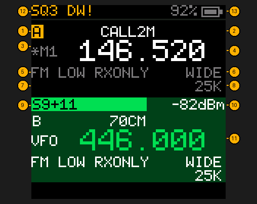
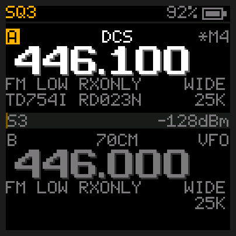
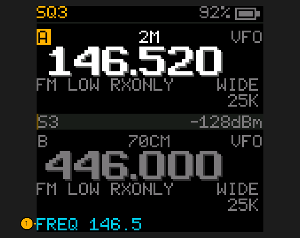
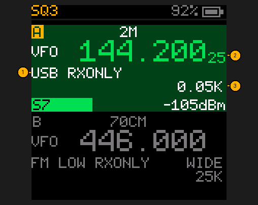

# The home screen

## Quick reference

| I want to… | Press or look at |
|---|---|
| Swap between slot A (top) and B (bottom) | **#** |
| Switch frequency mode / memory channels | **V/M** |
| Type a frequency | 6 digits (`146520`), or fewer then **MENU** |
| Fix a typing mistake | **V/M** deletes the last digit |
| See if a signal is coming in | The slot turns dark green, its frequency goes green |
| See how strong it is | The meter bar, with `S5` and `-102dBm` inside it |
| Clear a message on the bottom line | Any key (or wait 3 s) |
| Listen to SSB or Morse code (USB) | **MENU**, **0** **6** (MODE), **MENU**, **UP** **UP** (until it says `USB`), **MENU**, **V/M** |

The radio has two **slots**, A and B. Each holds one frequency or one memory channel. You listen
to the **selected** slot (bright); the other waits (dim) until you press **#** to swap, or use
dual watch to listen to both.

Both slots are laid out the same way, under a status bar. The meter sits between them.

1. **Slot letter.** The selected slot's letter sits in a lit block.
2. **Name.** The memory channel's name, or the band (`2M`, `70CM`) in frequency (VFO) mode.
3. **Memory number.** `M20` is memory channel 20; a `*` in front means it's on the scan list.
   `VFO` in frequency mode.
4. **Frequency** in MHz. Green while a signal is coming through, red while transmitting. Digits
   below 1 kHz show small after it: GMRS channel 1 reads `462.562` with a small `5` (462.5625 MHz).
   In USB the last two digits are always there.
5. **Mode, power and shift**: `FM`, `AM` (aircraft) or `USB` ([SSB](#listening-to-ssb), with just `RXONLY` after it); transmit power `HIGH`, `MID`, `LOW` or
   `ULOW` (ultra-low); the repeater shift, `-0.6` (transmit 0.6 MHz below) or `+5` (5 MHz above), nothing
   when simplex, or `TXLOCK` / `RXONLY` when the channel can't transmit. In frequency mode with
   MENU → SHIFT on AUTO (the default), this is the shift the radio picked for the frequency you
   tuned, from the band plan (see SHIFT in the [Menu](Menu)): type 146.940 and it shows `-0.6`.
6. **Bandwidth**: `WIDE`, or `NARR` (narrow FM). Match what the station uses.
7. **Tones**: `T100.0` is sent when you talk, `R100.0` is needed to hear the station, `TSQL100.0`
   (tone squelch) is both. See CTCSS/DCS in the [Glossary](Glossary). On the slot you're
   hearing, this line shows touch-tone digits when someone sends them (`DTMF 5551234#`, bright,
   for 10 seconds after the last digit; see DTMF in the [Glossary](Glossary)), from any brand of
   radio or repeater. It waits for a run of
   three or more, close together, and shows them once the sender pauses. A voice can sound like
   touch-tones for a moment; the radio counts a digit only when it is one steady tone followed by a
   short silence, the way a keypad sends it, so talking doesn't fill the line with digits. Holding
   a key down on the other radio gives one digit. Or the tone a station is using (`HEARD 100.0 6:copy`).
8. **Tuning step** for UP/DOWN in frequency mode (`25K` = 25 kHz; `0.05K` = 50 Hz in USB).
9. **Signal meter**: one bar across the screen, filling to the right as the signal gets stronger.
    Dim amber while it's just noise (in the theme's own colour: dim red in NIGHT RED); green once the
    squelch opens on a real signal, however strong, and then the rest of the bar takes the same dark
    green as the slot you're hearing, which runs right up to the bar with no dark line between. With
    the squelch at S1-S9 it stays dim until the signal reaches that S-unit, and a thin white line marks
    that level, so you can see how far over it a station is. The reading changes three times a second,
    slow enough to read on a signal that flutters; a new channel's reading shows at once, and so does the
    squelch opening or closing.
10. **Signal strength**, twice, inside the bar: in S-units at the left, `S0` to `S9`, then `S9+10` and
    so on (dB over S9), and in dBm at the right (`-102dBm`: the closer to zero, the stronger; -120 is a
    whisper, -60 is very strong).
11. **The other slot**, dim, waiting. Same layout. Here dual watch has caught a station on it, so
    its whole block is tinted green and its text turns bright, so it reads on the green.
12. **Status bar.** The squelch level always comes first, top left (`SQ3`, or `SQS5` when the
    squelch goes by the meter: only stations at S5 or stronger are heard; see SQUELCH in the
    [Menu](Menu)). After it, what's switched on: `SCAN G1`, `DW` (dual watch), `PRI` (priority),
    `WX` (weather alert), `MON`, `REV`, `ATT` (attenuator), `VOX`, the flashlight (`MOON`, `LOW`, `MED`,
    `HIGH`, `STROBE`, `SOS`). `DW!` or `PRI!` means you're hearing a call dual watch or priority
    caught (here `DW!`: slot B's station). A padlock when
    the keypad is locked (red when PTT is locked too: KEY LOCK in the [Menu](Menu)), the Bluetooth sign when Bluetooth is on, and a bell when someone called
    while BELL was on (see the [Menu](Menu); any key clears it) sit just left of the battery.
    The radio has two status lights, the left one for slot A and the right
    one for slot B: green on the slot you're hearing (dual watch catching a call on the other slot
    lights that slot's light; a priority or weather check lights the selected slot's), red on the
    slot you're transmitting on, dark otherwise. Both lights blink amber (a short flash about once a
    second) while a weather alert sounds or a BELL call is waiting; any key stops it.
    You can also tell from the slots themselves: the slot you're **hearing** gets a **dark green**
    background (the whole block, from its letter down to its tones), and the slot you're
    **transmitting** on a **dark red** one. With dual watch that's whichever slot the call is on.
    The other themes use a dark shade of their own colour; NIGHT RED stays all red, dim while
    receiving and brighter while transmitting.
13. **Battery**: percent and an icon that fills with the charge, red at 20% and below. The percent
    follows how a lithium-ion pack really drains (it sits near 7.6 V for most of its charge), so it
    goes down evenly: 8.4 V is 100%, about 7.6 V is 40%, and 0% is 6.8 V, where `LOW BATTERY` warns.

The bottom line is for messages (`TX LOCKED CHANNEL`, `LOW BATTERY`) and what you're typing.
A message goes away by itself after 3 seconds, or when you press a key. `LOW BATTERY` is the
exception: it stays until you press a key, so you don't miss it, and so does `PTT HELD: LET GO`
until you let go of PTT.

| Message | Means |
|---|---|
| `18-999 MHz ONLY` | The frequency you typed is outside what the radio can hear |
| `NO SUCH CHANNEL` | The channel number you typed is empty |
| `NO CHANNELS LOADED` | **V/M** or DELETE CH found no memory channels: load some first ([Channels and scanning](Channels-and-Scanning)) |
| `MEMORY CHANNELS ONLY` | CH GROUPS, CH NAME and CH TO VFO work on a memory channel: press **V/M** first |
| `SCAN LIST EMPTY` / `GROUP IS EMPTY` | No channels to scan there |
| `CHANNEL SKIPPED` | Hold **V/M** while scanning took this channel off the scan list for good (hold **V/M** on it to put it back) |
| `SQUELCH IS OPEN` | A scan can't start with the squelch at 0 or monitor on |
| `SAVED CH 005` / `SAVE FAILED` | Hold **MENU**'s save worked, or didn't |
| `LOW BATTERY` | Under 6.8 V: charge it soon |
| `TX NOT ALLOWED`, `TX LOCKED CHANNEL`, `BUSY: NO TX`, `BATTERY LOW: NO TX`, `PTT HELD: LET GO`, `LOCKED: NO TX` | PTT was refused: see [Transmitting](Transmitting) |

On a memory channel the slot looks like this. `M4` replaces `VFO`, the channel's name sits above the
frequency, and the line under the mode shows its tones: here `TD754I` is sent when you talk and
`RD023N` is needed to hear the station.

## Typing a frequency

1. **The bottom line shows what you've typed**, with the decimal point placed for you. Six digits
   tune immediately (`146520` = 146.520 MHz); MENU accepts fewer (`146` MENU = 146.000). A sixth
   digit of 2 or 7 gets its last half kilohertz, so the 12.5 kHz channels can be typed:
   `462562` = 462.5625 MHz (GMRS channel 1). V/M
   deletes the last digit. In memory mode the same line says `CHANNEL` and takes three digits.
   A number left half typed for 20 seconds is dropped.

## Listening to SSB

SSB (single sideband) is how hams talk across hundreds of miles on 2 m and 70 cm with little
power, and how satellites send voice and Morse code. It sounds like a duck talking until it is tuned
to within about 50 Hz, so it has its own fine step. This radio only listens to it: it can't send SSB.

1. In frequency mode, **MENU**, **0** **6** (MODE), **MENU**, **UP** until it says `USB`, **MENU**, **V/M**.
2. Type the frequency: `144200` for the 2 m calling frequency, `432100` for 70 cm.
3. **UP** / **DOWN** move 50 Hz at a time. Hold **4** for a coarser or finer step: 0.05, 0.1, 1 or
   0.01 kHz. Tune until the voice sounds natural; Morse code is a clear tone.

1. **`USB RXONLY`**: the mode, and a reminder that PTT won't transmit (`TX NOT ALLOWED`).
2. **The last two digits**, small: tens and hundreds of hertz. Here 144.200 25 is 144.20025 MHz.
3. **The fine step**, `0.05K` = 50 Hz.

Good to know:

- Set FREQ CAL first (see the [Menu](Menu)). This radio's crystal can be 1 kHz off at 432 MHz,
  enough to make SSB sound wrong at the frequency it shows.
- SSB has no carrier, so the normal squelch can't tell a station from noise. SQUELCH 1-9 open on
  signal strength alone; set SQUELCH to 0 to hear everything, or to S1-S9 to hear only stations at
  that strength. A station may drop out between words if the squelch is close to its level.
- Lower sideband (LSB), used below 10 MHz, isn't offered. On 2 m, 70 cm and satellites everyone
  uses USB.
- A short rubber antenna hears few SSB stations: they are weak and far away. An outdoor antenna
  helps most.
