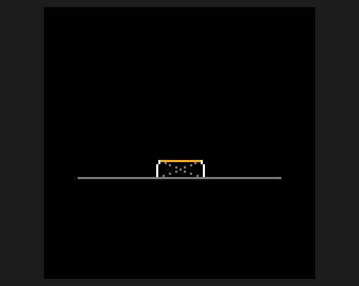

# TD-H3 open firmware: the manual

This is the manual for the open firmware on a TIDRADIO TD-H3 handheld radio. It assumes no radio
experience: words like *squelch*, *repeater* and *CTCSS* are explained in the [Glossary](Glossary).

**For the TD-H3 only, not the TD-H3 Plus.** The Plus is a different radio inside (a different chip, updated a different way), so this firmware can't run on it, and the flasher won't find it.

## Quick reference

The everyday moves on one page. Short press = tap and let go; hold = about one second.

| I want to… | Press |
|---|---|
| Go to a frequency | Type 6 digits: `1` `4` `6` `5` `2` `0` = 146.520 MHz |
| Go to a memory channel | **V/M** for memory mode, then type 3 digits (`0` `1` `2` = channel 12), or **UP / DOWN** |
| Switch between the top (A) and bottom (B) slot | **#** |
| Scan | **\*** to start. **\*** stops on what it found (a list to pick from if it found several), or back where you started if it found nothing; **V/M** stops and goes back where you started |
| Scan the other way, or skip a station | While scanning, **UP** or **DOWN** |
| Scan one group only | While scanning, **1**-**8** picks that group; **0** the whole scan list |
| Skip a noisy channel while scanning | Hold **V/M**: it leaves the scan list for good (hold **V/M** on it later to put it back) |
| Listen to everything, noise too (monitor) | Hold **1**; again to stop |
| NOAA weather radio | Hold **#**; hold **#** again to go back |
| FM broadcast radio | Hold **8**; **V/M** to leave |
| Dual watch (listen to A and B) | Hold **9** |
| Lock the keys | Hold **\***; hold again to unlock. **PTT**, **side key 1** and the flashlight still work while locked (set KEY LOCK to KEYS+PTT to lock PTT too) |
| Talk | Hold **PTT** (slot A) or the small **side key 1** (slot B); let go to listen |
| Send touch-tones (DTMF) | Keep holding **PTT** and press the digits; **MENU** then **1**-**8** sends a stored code |

**Flashlight, side key 2** (works even locked): tap on/off · hold while off for moonlight (keep
holding 5 s for SOS) · hold while on to step moonlight, low, medium, high · double tap for high ·
triple tap for strobe · any tap stops strobe or SOS.

**Menu:** **MENU** opens it, then type the item's number to jump there (`2` `3` = item 23; for 1-5 type the digit and wait a second).
**UP / DOWN** move, **MENU** selects (then **UP / DOWN** change the value, **MENU** done), **V/M** goes back. Every list works this way. Handy numbers:

| # | Item | # | Item |
|---|---|---|---|
| 1 | SQUELCH | 29 | FM RADIO |
| 2 | ATTENUATOR | 30 | WEATHER |
| 13 | TX BANDS (where you may transmit) | 31 | LAST HEARD (who was on) |
| 15 | TAIL TONE | 41 | WX ALERT |
| 20 | SCAN GROUP | 42 | AUTO OFF |
| 23 | DUAL WATCH | 44 | PC LINK (for CHIRP) |
| 25 | GROUP LINK (scan several groups) | 45 | REMOTE (for the computer) |
| 26 | CH GROUPS (a channel's scan groups) | 50 | VERSION |

**Flashing new firmware:** download the flasher for your computer from the newest release (the
firmware is inside it) and open it with the radio plugged in. With the radio on and REMOTE on, press and hold
**PTT** when it says so, and let go at **flash mode**. The first time (the
radio still on TIDRADIO's firmware), or with the radio off: switch it off, hold **PTT**, switch it
on, and let go after 2 seconds. See [Updating the firmware](Updating).

## What this radio does

- **Listens** to anything from 18 to 999 MHz: ham repeaters, GMRS, NOAA weather, marine, aircraft.
- **Talks** on the 2 m and 70 cm ham bands and GMRS (MURS and FRS too, if you switch them on), if you
  hold the licence and run the transmit build. The receive-only build can't transmit at all.
- **Scans** your channel list, or one group of it, fast, and stops on anything active.
- **Plays FM broadcast radio** with presets and seek.
- **Has a flashlight** with four brightness levels (moonlight to high), strobe and SOS.

## Start here

1. **[The home screen](Home-Screen)**: what every part of the display means.
2. **[Keys](Keys)**: what each button does, short press and held.
3. **[Channels and scanning](Channels-and-Scanning)**: load your channel list, scan groups.
4. **[FM radio](FM-Radio)**: listen to broadcast stations.
5. **[Tools](Tools)**: scope, freq find, last heard, weather alert, flashlight, keypad lock.
6. **[Menu](Menu)**: every setting.
7. **[Transmitting](Transmitting)**: licences, what's allowed, and the safety limits built in.
8. **[Updating the firmware](Updating)**: flashing a new version.
9. **[Glossary](Glossary)**: radio words in plain English.

For people working on the firmware: [Keeping this manual current](Keeping-This-Manual-Current).

## The two builds

| Build | File | Transmits? |
|---|---|---|
| Receive-only | `td-h3-rx.bin` | Never. PTT shows **TX NOT ALLOWED**. |
| Full | `td-h3.bin` | Only on the services on in TX BANDS (HAM and GMRS to start with), and only with the radio's factory calibration present. |

MENU → VERSION (item 50) shows which version you're running, for example `0.55.2`.

## About this firmware

This firmware isn't made, supported or endorsed by TIDRADIO. Installing it is at your own risk, and
TIDRADIO's firmware can always be put back ([Updating](Updating#going-back-to-tidradios-firmware)).
It's open source: MIT, with a few parts under Apache-2.0. The credits and licences are in the
project's [README](https://github.com/limehawk/td-h3-fw#credits) and NOTICE file. TIDRADIO and
TD-H3 are TIDRADIO's trademarks; other brand names in this manual belong to their owners and are
named only to compare.
