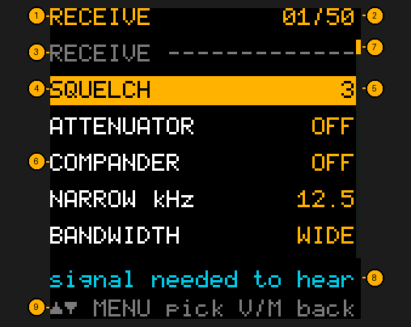

# Keeping this manual current

## Quick reference

| I want to… | Run |
|---|---|
| Check the manual's menu numbers (and everything else) | `make -C fw test` |
| Remake the screenshots | `make -C fw screenshots` |
| Remake the README's demo GIF (and an MP4 for posting) | `make -C fw demo` |
| Publish to the wiki | `make -C fw wiki` |

The manual is part of the firmware. A change that someone can see or feel on the radio isn't done
until the manual says so.

## The rule

**Every commit that changes what the radio shows or does updates the manual in the same commit**:
a new or changed key, menu item, screen, message, limit or default.

- The **Quick reference** at the top of every page: any key, menu number or flashing step it lists.
  Each page opens with one, a short "I want to… | Press" table of its most common moves.
- Menu numbers: `make -C fw test` fails if any page's `| 13 | TX BANDS |`, `TX BANDS (item 13)` or
  `**1** **3** (TX BANDS)` no longer matches the firmware's menu. Write them one of those ways.
- Flashing or the `tdh3` tool: [Updating the firmware](Updating), and every `tdh3` command in [The tdh3 program](The-tdh3-Program).
- Text: the page under `docs/manual/` that covers it.
- Pictures: `make -C fw screenshots` regenerates every screenshot from the real firmware, and the
  `term-*.png` pictures of `tdh3` from the real program. Commit the images that changed.
- Callout numbers live in `tools/screens.py` (`CALLOUTS`) and in the page's numbered list. Change
  one, change the other.
- A new screen: add a capture step to `tools/screens.py`, callouts in `CALLOUTS` (or its name in
  `PLAIN` for a picture with no numbers), a section to the page, and the picture to
  [Screenshots](Screenshots).



## Publishing

The source is `docs/manual/` in the repository. The wiki on GitHub is a published copy:

```bash
make -C fw wiki
```

Never edit the wiki in the browser: the next publish overwrites it. Edit `docs/manual/` instead.
(GitHub makes a wiki's git repository only when its first page is saved in the browser, so a new
copy of the project needs that one page first; the publish replaces it.)

## Writing for the reader

The reader may never have used a two-way radio. Plain words, one idea per sentence, the exact key
to press, and what they'll see when they press it. Radio terms get a [Glossary](Glossary) entry
the first time a page needs them.
