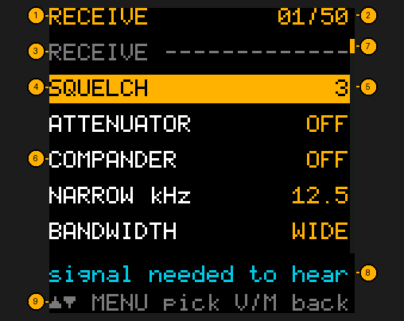
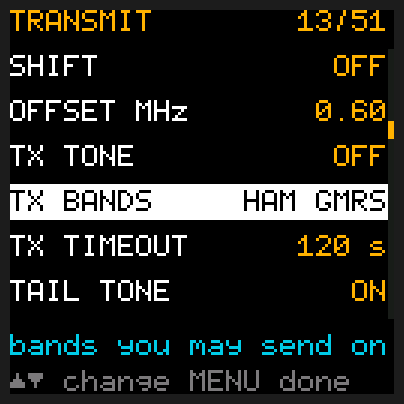
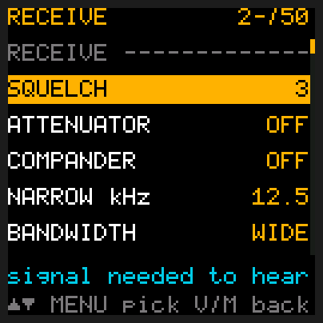
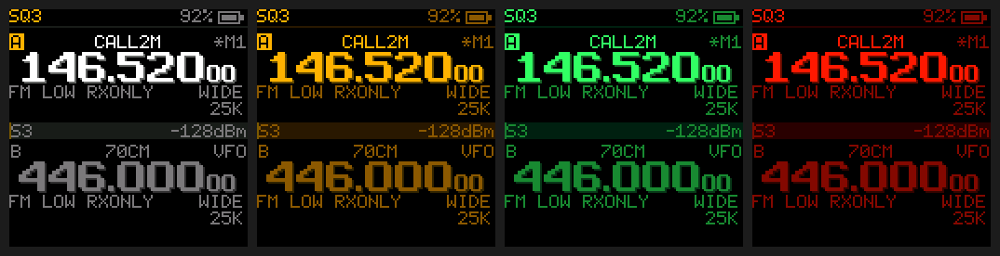
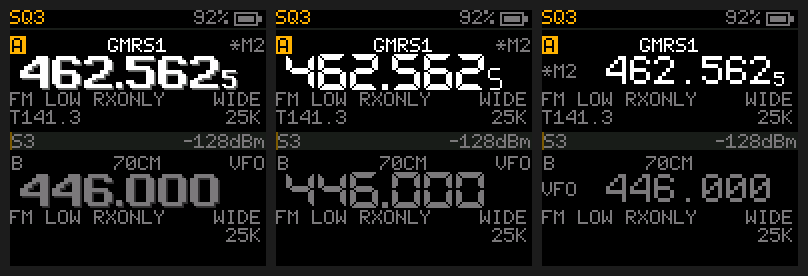
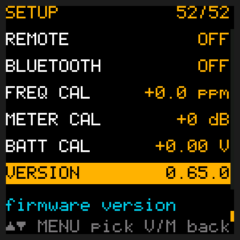

# Menu

## Quick reference

| I want to… | Press |
|---|---|
| Open the menu | **MENU** |
| Go straight to an item | Type its number: **2** **3** = item 23 (for 1-5, one digit and wait a second) |
| Move up / down the list | **UP** / **DOWN** |
| Change a setting | **MENU**, then **UP** / **DOWN**, then **MENU** |
| Open a tool (a `>` item) | **MENU** |
| Go back / leave the menu | **V/M** (twice from a value) |

The items are grouped by what they're for, in six sections, each under a dim heading:
RECEIVE, TRANSMIT, SCAN, TOOLS, DISPLAY & SOUND and SETUP. The section you're in shows at the top.
The menu opens on the item you used last. While you change a setting its row turns white;
**MENU** or **V/M** says you're done. Every list on the radio uses the same keys.

A change counts the moment you make it (and is saved two seconds after your last one), so going back
never loses it. An open menu goes back to the radio after 20 seconds untouched.

The radio keeps listening while the menu is open: a call plays through the speaker as usual, and the
green light shows it. Dual watch and the priority channel wait until you leave the menu. Opening a
tool (a `>` item) quiets the speaker until you're back in the list.

To go straight to an item, type its number from the table below: **1** then **2** opens item 12.
Items 6-9 open as soon as you type the digit. For items 1-5, type the one digit and wait a second
(or type **0** first: **0 5** is item 5), because 1-5 can also start a two-digit number. The first
digit shows up top while the radio waits for the second. A number past 52 gives the "not possible" sound.

Items 5-12 (BANDWIDTH to TX TONE) set up frequency mode. When the selected slot is on a memory channel
their values show **VFO** in front (`VFO LOW`): changing them doesn't change the channel.

1. **The section** you're in: the list is in six (RECEIVE, TRANSMIT, SCAN, TOOLS, DISPLAY & SOUND, SETUP).
2. **Where you are**: item 1 of 52.
3. **A section's heading**, dim, with a dashed line. UP/DOWN step over it; item numbers count only items.
4. **The selected item**, highlighted.
5. **Its value.** MENU, then UP/DOWN changes it.
6. **The items around it**, each with its current value at the right, so you can read your settings at a glance.
7. **The scroll bar**: how far down the list you are.
8. **What the item does**, in a few words. The table below says more.
9. **Keys** reminder: it changes to say what the keys do while you change a value.

**Changing a setting.** Press **MENU** on an item and its row turns white: **UP** and **DOWN** now change
the value, and the bottom line says so. **MENU** or **V/M** says you're done.

**Typing an item's number.** The first digit shows at the top right while the radio waits a second
for the second one; here `2-` after pressing **2**.

## All items

### Receive

| # | Item | What it does |
|---|---|---|
| 1 | SQUELCH | 0-9, then S1-S9. How strong a signal must be before you hear it. Higher = only stronger signals; 0 = always open (hiss). 3 suits most places. **S1-S9** go by the signal meter instead: you hear only stations at that S-unit or stronger (S9 is a strong, close station; S5 a fair one), handy when a busy band or a nearby noise source keeps opening the squelch. Once a station is heard it stays on until it drops 3 dB (half an S-unit) under the level, so it doesn't chop on the edge. S1-S4 sit below the radio's own squelch, so they act like squelch 2. |
| 2 | ATTENUATOR | OFF (default) or ON. ON turns the receiver's gain down about 10 dB, like the ATT button on bigger radios. Use it when a strong station nearby (a repeater site, a radio in the next car) swamps weaker ones or makes the meter sit high. ATT shows in the status bar while it is on. |
| 3 | COMPANDER | OFF (default), RX, TX or BOTH. Cuts the hiss behind a weak voice, but only when the radio at the other end has its compander on too: then use BOTH on both radios. RX works on what you hear, TX on what you send. With only one end on, voices sound uneven, swelling and fading. Leave it OFF unless your group agrees to use it. |
| 4 | NARROW kHz | 12.5 (default) or 6.25. How narrow NARROW is, on every narrow channel and narrow frequency. 6.25 cuts out a strong station right next door (6.25 kHz away) but a normal narrow station may then sound distorted. Little use in the US, where voice channels aren't that close together: leave it at 12.5 unless you know your area uses 6.25 kHz channels. WIDE is not affected. |
| 5 | BANDWIDTH | WIDE (default) or NARROW FM. Match what the station uses (GMRS and most ham repeaters are wide). |
| 6 | MODE | How the radio turns a signal into sound: FM (default), AM or USB. It sets the selected slot's frequency mode, and A and B each keep their own. **FM** is what almost every handheld, repeater and GMRS radio uses. **AM** is what aircraft use; the air band (108-137 MHz) is AM even when this says FM. **USB** (upper sideband, a kind of SSB) is for weak, far-off ham stations, Morse code and satellites: see [Listening to SSB](Home-Screen#listening-to-ssb). AM and USB are receive only: PTT gives `TX NOT ALLOWED`. A frequency saved as a channel keeps its mode. |
| 7 | STEP kHz | Tuning step for UP/DOWN in frequency mode: 2.5, 5, 6.25, 10, 12.5, 20, 25, 50, 100, then 8.33, 15 and 30 kHz. 25 is the default and suits GMRS; 5 or 12.5 for 2 m, 8.33 for European air band (it lands on the real 8.33 kHz channels, shown as 118.000, 118.008, 118.016, 118.025 ...). In USB, UP/DOWN use their own, finer step instead (hold **4**). |
| 8 | RX TONE | Tone needed to *hear* a station, or OFF (default): the 50 CTCSS tones 67.0-254.1 Hz, then the 104 DCS codes normal (`D023N`) and inverted (`D023I`). |

### Transmit

| # | Item | What it does |
|---|---|---|
| 9 | POWER | Transmit power, lowest to highest: ULTRA LOW, LOW (default), MID, HIGH. MID sits between LOW and HIGH, worked out from your radio's own factory settings for both. |
| 10 | SHIFT | Repeater offset direction in frequency mode: OFF, +, - or AUTO (default). AUTO picks the shift from the US band plan for the frequency you tune: 145.10-145.50 and 146.61-146.97 MHz transmit 0.6 MHz below, 147.00-147.39 MHz 0.6 MHz above, 442-445 MHz 5 MHz above, 447-450 MHz 5 MHz below, GMRS repeater channels 15-22 (462.550-462.725 MHz, 25 kHz apart) 5 MHz above; anywhere else it is simplex (no shift), GMRS channels 1-14 included. The home screen shows what it picked. AUTO only knows the US plan: outside the US, or for a repeater that doesn't follow the plan, set + or - by hand. Memory channels keep their own shift. |
| 11 | OFFSET MHz | How far the transmit frequency is from the one you hear, used with SHIFT + or -. The radio keeps two: one for VHF (under 300 MHz, 2 m and the other low bands) and one for UHF (300 MHz and up, 70 cm and GMRS). This item shows and changes the one for the band the selected slot is on, and the other stays as it was. UP and DOWN move it by 0.05 MHz, from 0.05 to 12.75, and it goes round past either end; hold the key to move quickly. VHF starts on 0.60 and UHF on 5.00. AUTO doesn't use these: it picks 0.6 on 2 m and 5.0 on 70 cm and GMRS by itself. |
| 12 | TX TONE | Tone sent when you *talk*, usually what a repeater requires. Same choices as RX TONE; OFF by default. |
| 13 | TX BANDS | Which services PTT works on: HAM, GMRS, MURS, FRS, any mix, or NONE. HAM GMRS to start with. See [Transmitting](Transmitting). |
| 14 | TX TIMEOUT | Longest transmission: OFF, 30, 60, 120 (default), 180 s. A beep 10 s before. |
| 15 | TAIL TONE | ON (default), OFF or REVERSE. ON sends a short 55 Hz tone (or the DCS turn-off code) as you let go of PTT, so other radios close their squelch without a burst of noise. You don't hear it. Most radios, Chinese handhelds included, know this one: keep ON unless radios you talk to react badly to it. **REVERSE** is the way Kenwood and Motorola radios do it, a *reverse burst*: on a channel with a CTCSS TX tone, the tone itself is flipped for a moment instead of switching to 55 Hz. Radios that know a reverse burst then close without the noise; radios that only know 55 Hz may hear a short burst of noise instead. Channels with a DCS tone or no tone keep the ON behaviour. |
| 16 | MIC GAIN | 0-9, default 5. How loud your voice goes out. The radio also evens out your level by itself while you talk, so a soft voice still comes through and a shout doesn't distort; change this only if people tell you you're too quiet or too loud. |
| 17 | VOX | Transmit by talking, no PTT: OFF (default), or 1 (needs a loud voice) to 9 (picks up a quiet one). The radio keys up when it hears you on its microphone and goes back to listening after VOX DELAY of quiet. It only keys from the home screen, never while it hears a station, and never where PTT wouldn't (TX BANDS, busy lockout, a locked keypad with KEY LOCK KEYS+PTT); TX TIMEOUT still cuts it off. `VOX` shows in the status bar while it's on. BATT SAVE rests while VOX is on. See [VOX](Transmitting#vox-talk-without-pressing-ptt). |
| 18 | VOX DELAY | How long VOX stays on after you stop talking: 0.5, 1 (default), 1.5, 2 or 3 seconds. Longer rides over pauses between words. |
| 19 | DTMF CODES | The 8 touch-tone codes you can send while transmitting (hold PTT, press MENU, then 1-8). UP/DOWN pick one, MENU types it, MENU again saves. See [Touch-tones](Transmitting#touch-tones-dtmf). |
| 20 | CALL ID | Sends your ham callsign in Morse code when you let go of PTT, so you don't have to say it: OFF (default) or the callsign you type. MENU opens the same typing screen as CH NAME (up to 8 letters, digits and `/`); **MENU** saves, **V/M** goes back without saving. Save it empty for OFF. It sends only on the ham bands (2 m and 70 cm, never GMRS, MURS or FRS), the first time after you switch on and then at most once every 10 minutes. See [Call ID](Transmitting#call-id-your-callsign-in-morse). |

### Scan

| # | Item | What it does |
|---|---|---|
| 21 | SCAN GROUP | Which group a memory scan covers: SCAN LIST (default, every channel marked `*`), or GROUP 1-8 (its channels on the scan list). A group also limits UP/DOWN in memory mode to its channels. |
| 22 | SCAN PAUSE | Longest a scan stays on a busy channel before moving on, even if it is still busy (a weather broadcast never stops): 2, 5, 10, 20 s, or BUSY (default): no limit, it stays as long as someone is talking. |
| 23 | SCAN RESUME | How long a scan waits after the signal drops, so you hear the reply, before moving on: 0, 1, 2, 3, 5 s (default), or HOLD: stay the whole SCAN PAUSE time on a station, even after it goes quiet, then move on. HOLD here with SCAN PAUSE on BUSY stops the scan on the first station. |
| 24 | DUAL WATCH | ON (default) or OFF; hold **9** does the same. Check the other slot every half second (not while scanning). `DW` shows in the status bar, `DW!` while you're hearing a call it caught; PTT then answers on that slot. A signal there is taken only if it carries that slot's RX tone (when it has one). After a call it waits 3 seconds before looking again, so a station that fades for a moment isn't lost. |
| 25 | PRIORITY | OFF (default) or one of your memory channels, checked every 2 seconds, even while scanning, and every 5 seconds while you're listening to a call (a short gap in the audio). MENU, then UP/DOWN steps through OFF and your channels (`CH012`), MENU. `PRI` shows in the status bar, `PRI!` while you're hearing it. |
| 26 | GROUP LINK | Scan several groups at once, like the big rigs' bank link. MENU opens the eight groups; UP/DOWN moves, MENU puts one on or off, V/M goes back. SCAN GROUP shows the set (`G135`), and the status bar shows `SCAN G135` while scanning. None on: the scan list. |
| 27 | CH GROUPS | Which of the 8 scan groups the selected memory channel is in. MENU opens it; UP/DOWN moves, MENU puts a group on or off, V/M goes back (what you set is kept). Memory mode only (`MEMORY CHANNELS ONLY` otherwise). See [Scan groups](Channels-and-Scanning#scan-groups). |

### Tools

| # | Item | What it does |
|---|---|---|
| 28 | SCOPE | Same as long 3. See [Tools](Tools). |
| 29 | FREQ FIND | Same as long 7. |
| 30 | FM RADIO | Same as long 8. See [FM radio](FM-Radio). |
| 31 | WEATHER | Same as long #: NOAA weather radio. See [Weather](Channels-and-Scanning#weather). |
| 32 | LAST HEARD | The last 8 stations heard (`nothing heard yet` until then), newest first, with how long ago and the memory channel they were on. MENU opens it; UP/DOWN picks one, MENU tunes the selected slot to it, V/M goes back. Kept until you switch off. |
| 33 | CH NAME | Name the selected slot's memory channel, up to 8 letters, typed on the keypad like an old phone. MENU opens it; **MENU** saves, **V/M** goes back without saving. Memory mode only. See [Naming a channel](Channels-and-Scanning#naming-a-channel). |
| 34 | CH TO VFO | Copy the selected slot's memory channel into frequency mode, so you can tune around it with UP/DOWN without changing the channel. Its frequency, tones, shift, bandwidth and power become the frequency-mode settings. MENU does it. Memory mode only. See [Copying a channel to frequency mode](Channels-and-Scanning#copying-a-channel-to-frequency-mode). |
| 35 | DELETE CH | Empty a memory channel (`NO CHANNELS LOADED` when there are none). MENU opens a list of your channels on the selected slot's; UP/DOWN picks one, MENU asks `DELETE 002 GMRS1?`, MENU again deletes it, V/M keeps it. See [Deleting a channel](Channels-and-Scanning#deleting-a-channel). |

### Display & sound

| # | Item | What it does |
|---|---|---|
| 36 | LIGHT | How long the backlight stays on after a key: 10 s, 30 s (default) or ON (always). It stays on while a signal comes in or you talk. On a dark screen, the first key only lights it (PTT always transmits). When the light goes out, the screen switches off too, to save battery; it comes back with the light, showing what changed meanwhile. How bright it is: BRIGHTNESS. |
| 37 | BRIGHTNESS | How bright the screen's backlight is: 1 (dimmest) to 5 (brightest, the default). The screen changes as you pick, so you can see it. A lower level saves battery and is easier on your eyes at night. LIGHT still decides how long it stays on. |
| 38 | THEME | The screen's colours: CLASSIC (default), NIGHT AMBER, GREEN, NIGHT RED (keeps your night vision), POCKET (dark green on pale green, like an old handheld game), NIXIE (warm orange on near-black, like glowing number tubes), E-INK (black on off-white, like an e-reader), FIELD (khaki on olive) or HIGH-VIS (black on bright yellow, easy to read in sunshine). The screen changes as you pick, so you can see it. This manual describes CLASSIC's colours (green while hearing, red while transmitting); every theme has its own shades for those. |
| 39 | DIGITS | How the big frequency numbers look: ARCADE (default), chunky with a soft shadow; LCD, like a digital clock; or CLASSIC, the plain look from before. With ARCADE and LCD, `VFO` or the memory number moves to the top right of the slot, next to the name. The screen changes as soon as you leave the menu. A computer watching over REMOTE (`tdh3 remote screen`) shows the frequency in the CLASSIC look. |
| 40 | KEY BEEP | ON (default) or OFF. A soft click on key presses, and the sound at power-on. The radio's other sounds (errors, alerts) play either way. |
| 41 | KEY LOCK | What holding **\*** locks: KEYS (default), the keypad only, so PTT and side key 1 still transmit; or KEYS+PTT, the keypad and both transmit keys, for a radio in a pocket or bag. The flashlight works either way. The padlock in the status bar is red with KEYS+PTT. |
| 42 | BELL | OFF (default) or ON. For when you leave the radio listening and step away: when someone talks after the radio has been quiet for 10 seconds or more (no key pressed, no talking, no signal), it plays a short ding-ding and puts a bell at the top of the screen, so you know someone called. The bell, and both status lights blinking amber, stay until you press any key. It doesn't ring while scanning or for a call caught by DUAL WATCH, PRIORITY or WX ALERT, and not with the squelch held open (squelch 0 or monitor). |
| 43 | WX ALERT | NOAA channel to watch for the weather alert tone: checked every 5 s, also at squelch 0, with monitor on and from the FM radio. OFF (default) or 162.400-162.550. When the alert sounds, both status lights blink amber until you press a key. In weather mode (hold **#**) it listens for the alert tone all the time, and the alarm sounds once for each alert, so a key silences it even while the tone goes on. |
| 44 | AUTO OFF | Put the radio to sleep after 30, 60 or 120 minutes with no key pressed, no signal heard and no scan running: the receiver, screen, backlight and flashlight go off. Any key wakes it (that key does nothing else). While it sleeps it hears nothing: no dual watch, priority or weather alert. The power switch is the volume knob, so this is the "off" a forgotten radio gets. OFF by default. |
| 45 | BATT SAVE | While nothing is heard, the receiver naps between quick listens: OFF, SHORT, MIDDLE or LONG naps (0.12, 0.24, 0.48 s). Longer naps mean a longer battery but a slower catch: the first word of a call can be clipped. Starts at MIDDLE: about 5 days on a charge. |

THEME (item 38), row by row: CLASSIC, NIGHT AMBER, GREEN; NIGHT RED, POCKET, NIXIE; E-INK, FIELD, HIGH-VIS.

DIGITS (item 39), left to right: ARCADE, LCD, CLASSIC.

### Setup

| # | Item | What it does |
|---|---|---|
| 46 | PC LINK | Hand the radio to a computer (CHIRP, `tdh3`), over the USB-C cable, or over Bluetooth too when BLUETOOTH is on. The screen says *waiting for computer*; **V/M** leaves. The backlight goes out after the LIGHT time (any key lights it again), and after 10 minutes with nothing from the computer the radio goes back to listening by itself. See [Channels and scanning](Channels-and-Scanning#loading-your-channel-list), and [Updating](Updating#saving-and-restoring-your-settings) for backing up and restoring settings. |
| 47 | REMOTE | Let a computer see the screen and press keys (never transmit), or wait for something to happen: `tdh3 remote wait "squelch open"` returns when someone talks on the frequency. Off by default. |
| 48 | BLUETOOTH | OFF (default) or ON: the Bluetooth module, for programming from a phone. The Bluetooth sign shows in the status bar while it's on. |
| 49 | FREQ CAL | Fine frequency correction, -10.0 to +10.0 ppm in 0.1 steps. Leave at +0.0 unless you've measured an error. |
| 50 | METER CAL | Signal meter correction, -40 to +40 dB (default +0). |
| 51 | BATT CAL | Battery voltage correction, -1.00 to +1.00 V in 0.02 V steps (default +0.00). |
| 52 | VERSION | Firmware version, for example `0.55.2`. Nothing to change. |

