# Screenshots

## Quick reference

| I want to see… | Go to |
|---|---|
| The home screen | [The home screen](#the-home-screen) |
| The menu | [The menu](#the-menu) |
| Channels and scanning | [Channels and scanning](#channels-and-scanning) |
| FM radio | [FM radio](#fm-radio) |
| Tools | [Tools](#tools) |
| Transmitting | [Transmitting](#transmitting) |
| On the computer | [On the computer](#on-the-computer) |

Every screen in this manual, in one place, taken from the firmware and the `tdh3` program themselves.
Under each picture is a link to the page that explains it.

## The home screen

<table>
<tr><td valign="top">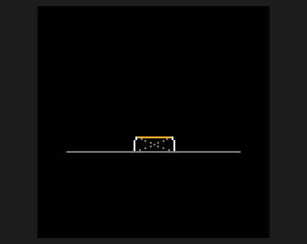 <b>Starting up</b> <a href="Home">The manual</a></td><td valign="top">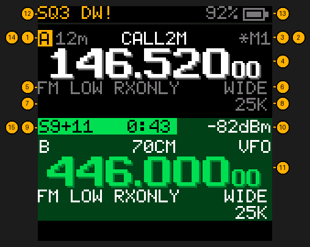 <b>The home screen</b> <a href="Home-Screen">What every part means</a></td></tr>
<tr><td valign="top">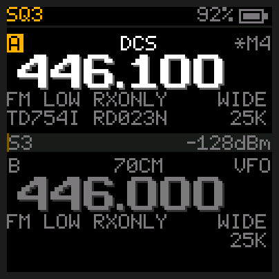 <b>On a memory channel</b> <a href="Home-Screen">The home screen</a></td><td valign="top">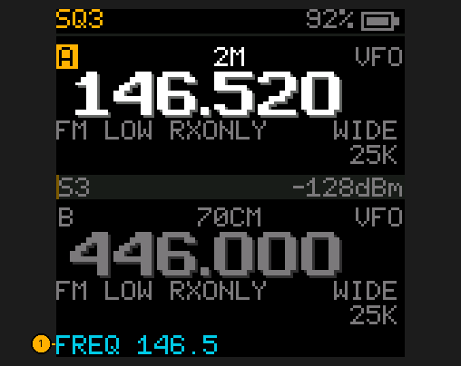 <b>Typing a frequency</b> <a href="Home-Screen#typing-a-frequency">Typing a frequency</a></td></tr>
<tr><td valign="top">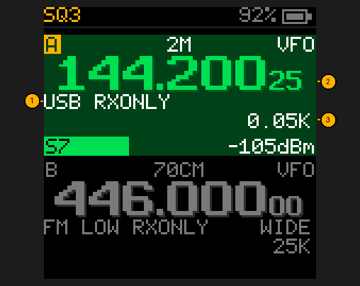 <b>Listening to SSB</b> <a href="Home-Screen#listening-to-ssb">Listening to SSB</a></td></tr>
<tr><td colspan="2">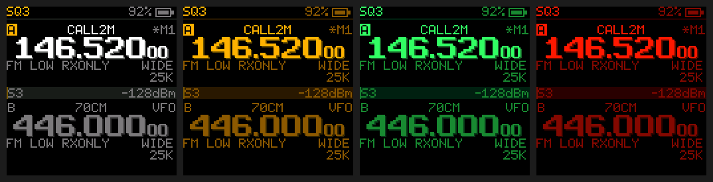 <b>The four themes: Classic, Night Amber, Green, Night Red</b> <a href="Menu#display--sound">Display and sound settings</a></td>
</table>

## The menu

<table>
<tr><td valign="top">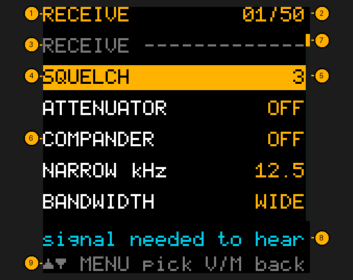 <b>The menu</b> <a href="Menu">Every setting</a></td><td valign="top">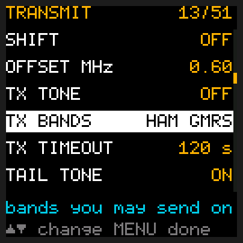 <b>Changing a setting</b> <a href="Menu">How the menu works</a></td></tr>
<tr><td valign="top">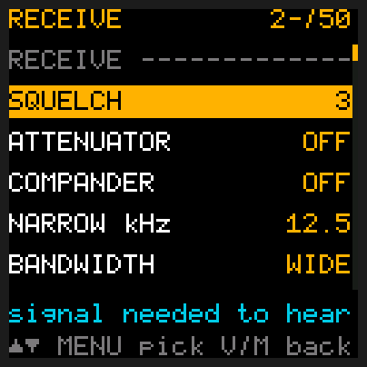 <b>Typing an item number</b> <a href="Menu">How the menu works</a></td><td valign="top">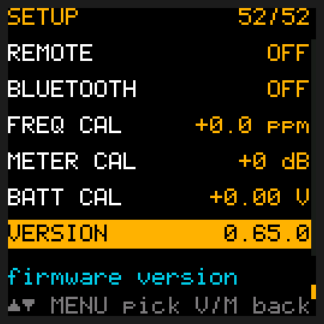 <b>The firmware version</b> <a href="Menu#setup">Setup settings</a></td></tr>
</table>

## Channels and scanning

<table>
<tr><td valign="top">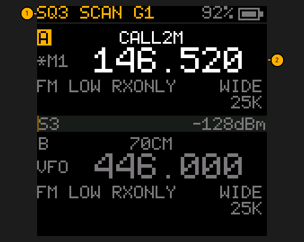 <b>Scanning a group</b> <a href="Channels-and-Scanning#scanning">Scanning</a></td><td valign="top">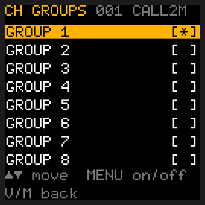 <b>Which groups a channel is in</b> <a href="Channels-and-Scanning#scan-groups">Scan groups</a></td></tr>
<tr><td valign="top">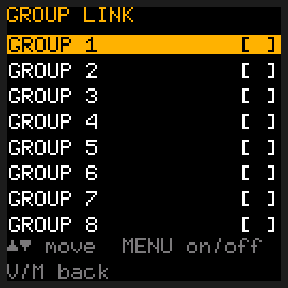 <b>Scanning several groups at once</b> <a href="Channels-and-Scanning#scan-groups">Scan groups</a></td><td valign="top">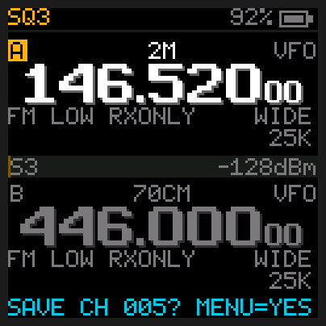 <b>Saving a frequency as a channel</b> <a href="Channels-and-Scanning#saving-a-frequency-as-a-channel">Saving a channel</a></td></tr>
<tr><td valign="top">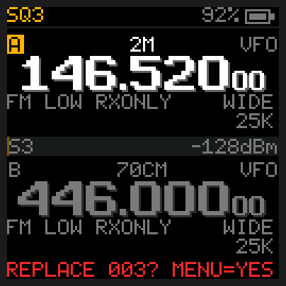 <b>Warning before writing over a channel</b> <a href="Channels-and-Scanning#saving-a-frequency-as-a-channel">Saving a channel</a></td><td valign="top">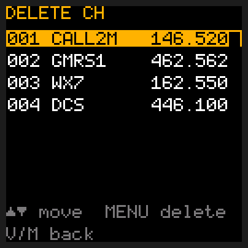 <b>Choosing a channel to delete</b> <a href="Channels-and-Scanning#deleting-a-channel">Deleting a channel</a></td></tr>
<tr><td valign="top">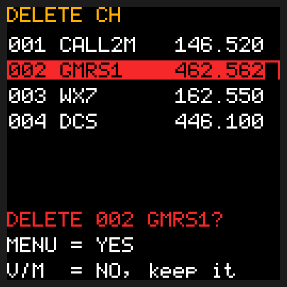 <b>Asking before it deletes</b> <a href="Channels-and-Scanning#deleting-a-channel">Deleting a channel</a></td><td valign="top">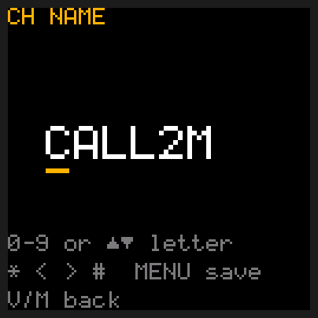 <b>Naming a channel</b> <a href="Channels-and-Scanning#naming-a-channel">Naming a channel</a></td></tr>
<tr><td valign="top">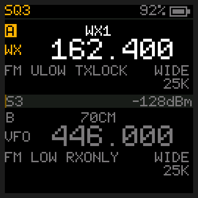 <b>NOAA weather radio</b> <a href="Channels-and-Scanning#weather">Weather</a></td></tr>
</table>

## FM radio

<table>
<tr><td valign="top">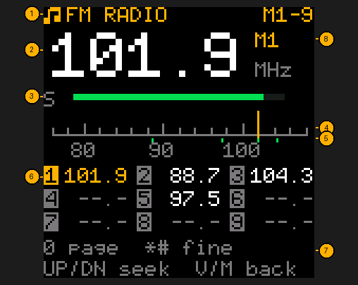 <b>FM broadcast radio</b> <a href="FM-Radio">FM radio</a></td><td valign="top">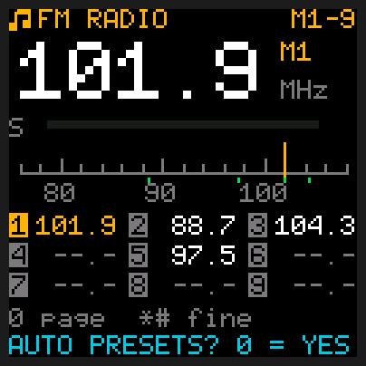 <b>Finding stations automatically</b> <a href="FM-Radio">FM radio</a></td></tr>
</table>

## Tools

<table>
<tr><td valign="top">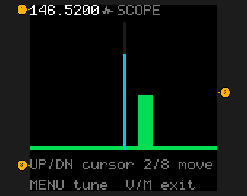 <b>The scope</b> <a href="Tools#scope-hold-3">Scope</a></td><td valign="top">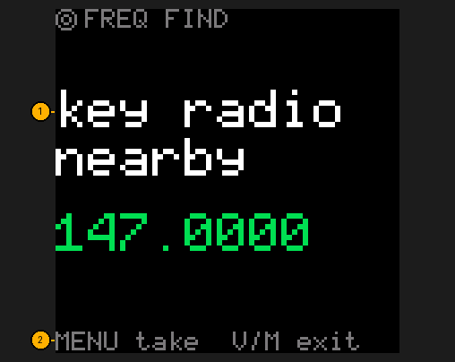 <b>Freq find</b> <a href="Tools#freq-find-hold-7">Freq find</a></td></tr>
<tr><td valign="top">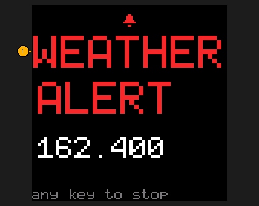 <b>A weather alert</b> <a href="Tools#weather-alert">Weather alert</a></td><td valign="top">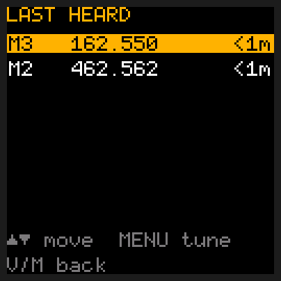 <b>Last heard</b> <a href="Tools#last-heard">Last heard</a></td></tr>
<tr><td valign="top">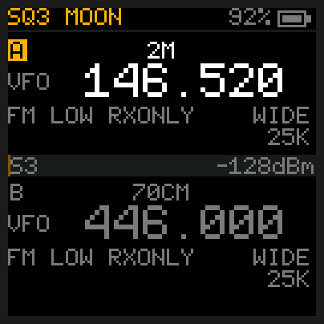 <b>The flashlight on moonlight</b> <a href="Tools#flashlight">Flashlight</a></td><td valign="top">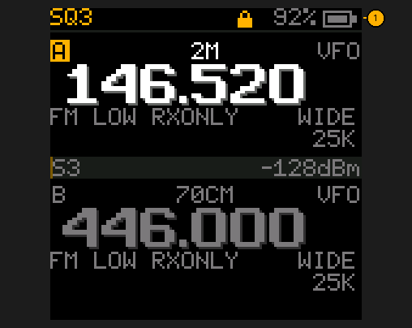 <b>The keypad locked</b> <a href="Tools#keypad-lock">Keypad lock</a></td></tr>
<tr><td valign="top">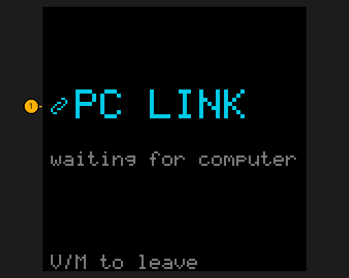 <b>PC LINK</b> <a href="Tools#pc-link">PC LINK</a></td><td valign="top">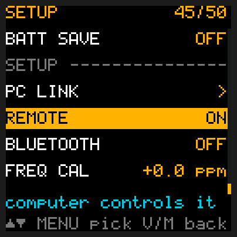 <b>REMOTE switched on</b> <a href="Tools#recording-the-screen">Recording the screen</a></td></tr>
</table>

## Transmitting

<table>
<tr><td valign="top">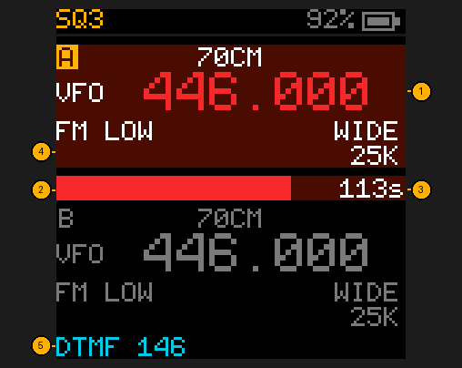 <b>Transmitting</b> <a href="Transmitting">Transmitting</a></td><td valign="top">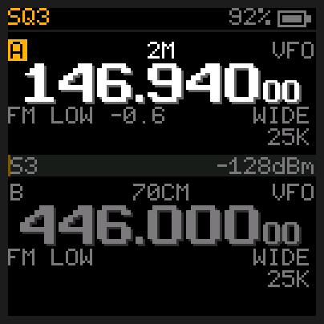 <b>A repeater shift</b> <a href="Transmitting">Transmitting</a></td></tr>
<tr><td valign="top">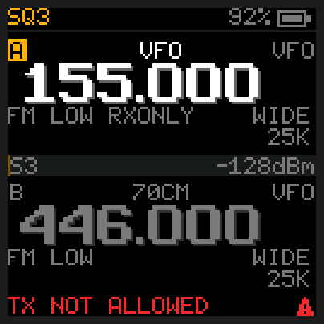 <b>Where it won't transmit</b> <a href="Transmitting">Transmitting</a></td><td valign="top">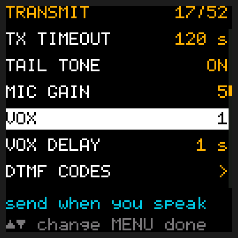 <b>Setting VOX</b> <a href="Transmitting#vox-talk-without-pressing-ptt">VOX</a></td></tr>
<tr><td valign="top">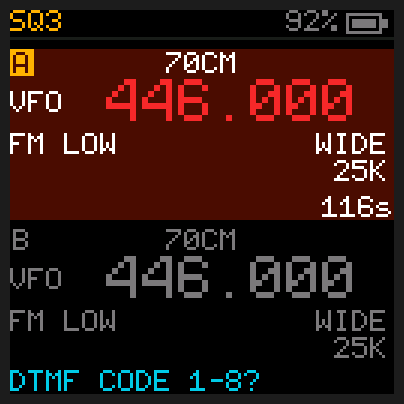 <b>Sending a stored touch-tone code</b> <a href="Transmitting#stored-codes">Stored codes</a></td><td valign="top">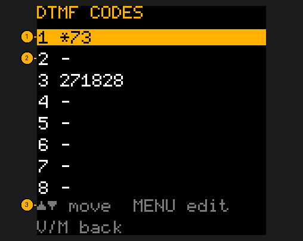 <b>The stored touch-tone codes</b> <a href="Transmitting#stored-codes">Stored codes</a></td></tr>
<tr><td valign="top">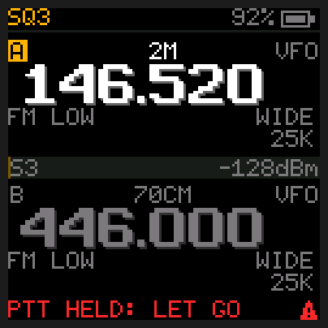 <b>PTT held while switching on</b> <a href="Updating#flash">Flashing</a></td></tr>
</table>

## On the computer

<table>
<tr><td colspan="2">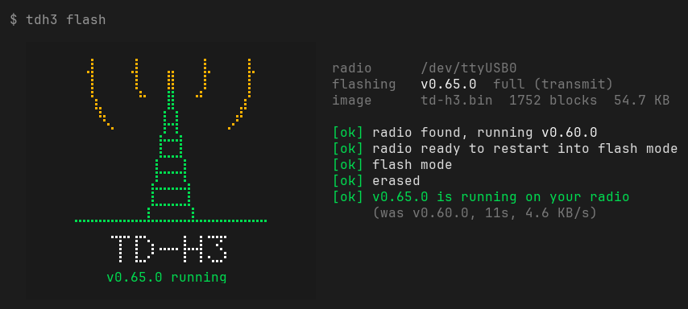 <b>The flasher when it has finished</b> <a href="Updating#flash">Flashing</a></td>
<tr><td colspan="2">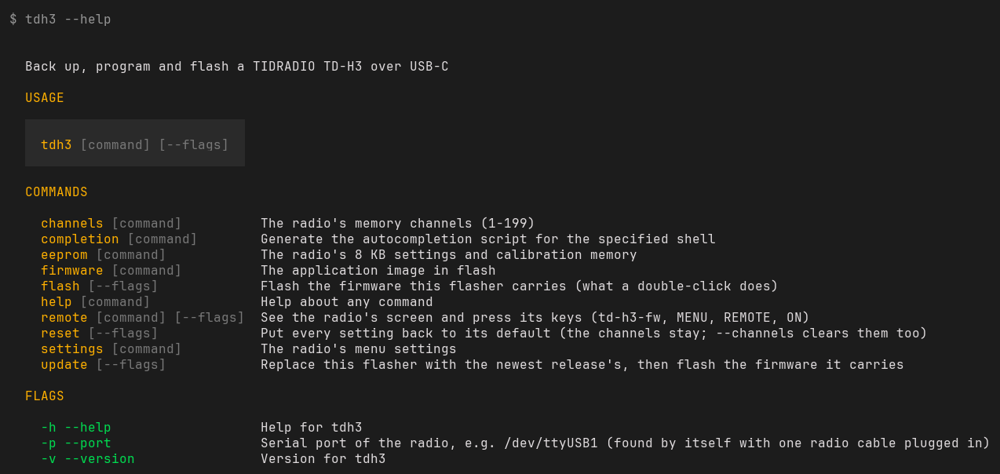 <b>Every tdh3 command</b> <a href="The-tdh3-Program">The tdh3 program</a></td>
<tr><td colspan="2">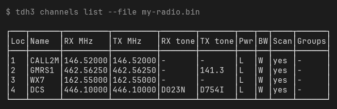 <b>Listing your channels</b> <a href="Channels-and-Scanning#changing-channels-from-the-computer">Changing channels from the computer</a></td>
<tr><td colspan="2">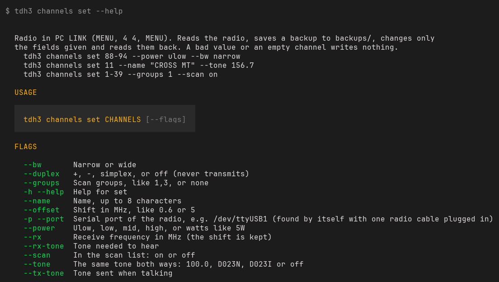 <b>Every way to change a channel</b> <a href="The-tdh3-Program#channels">The tdh3 program</a></td>
</table>
