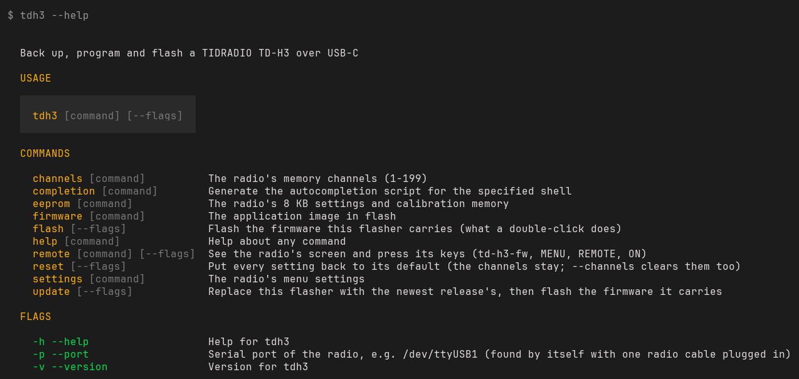
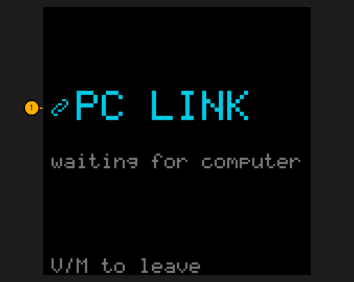
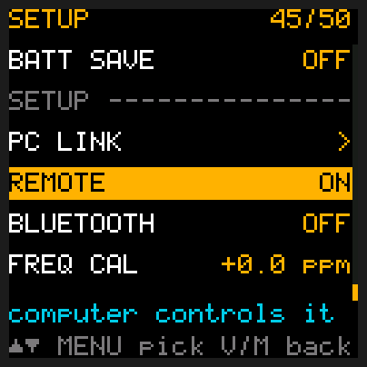
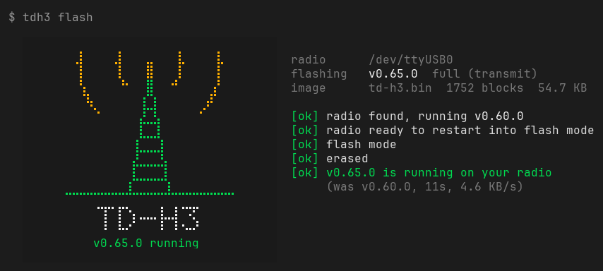
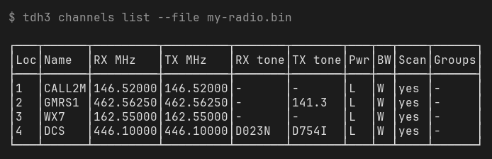
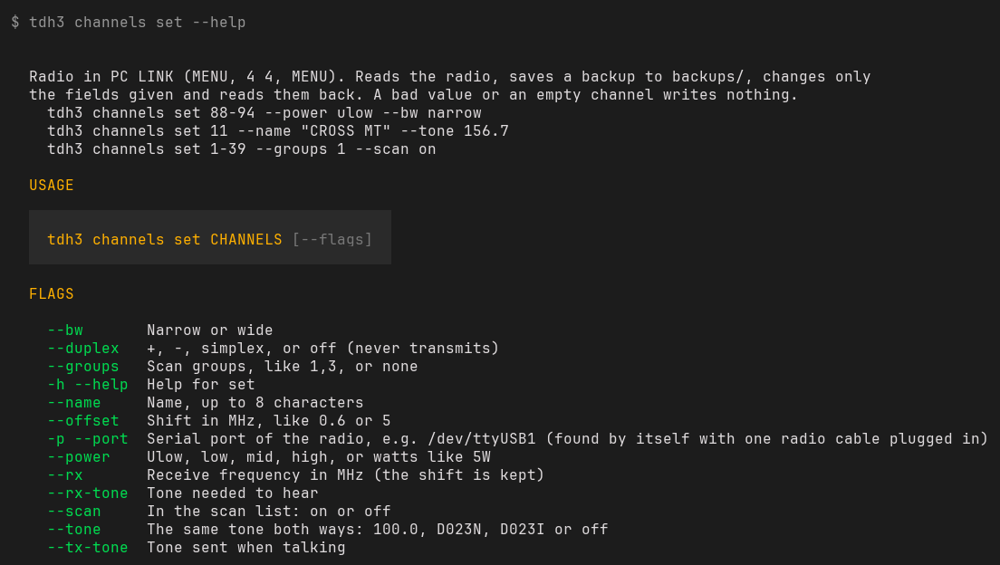
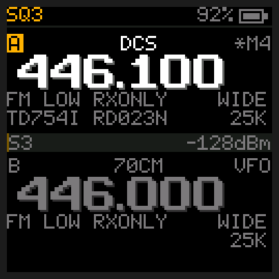

# The tdh3 program

`tdh3` is the flasher you downloaded. Besides putting firmware on the radio, it backs the radio up,
manages its channels and settings, and lets a computer see its screen and press its keys.

## Quick reference

| I want to… | Type | Radio needs |
|---|---|---|
| Put the firmware on the radio | `tdh3 flash` (or double-click the flasher) | Nothing: hold **PTT** when it asks |
| Get the newest version | `tdh3 update` | Internet, then hold **PTT** |
| See my channels | `tdh3 channels list` | PC LINK |
| Change channels | `tdh3 channels set 88-94 --power low` | PC LINK |
| Back up the radio | `tdh3 eeprom backup my-radio.bin` | PC LINK |
| Restore a backup to the radio | `tdh3 restore my-radio.bin` | PC LINK |
| See the backups I have | `tdh3 backups` | Nothing |
| See what changed since a backup | `tdh3 diff my-radio.bin` | PC LINK |
| Restore channels from a backup | `tdh3 channels copy my-radio.bin` | PC LINK |
| Restore settings from a backup | `tdh3 settings restore my-radio.bin` | PC LINK |
| See all my settings | `tdh3 settings show` | PC LINK |
| Change one setting | `tdh3 settings set POWER HIGH` | REMOTE on, or PC LINK |
| See what the radio shows | `tdh3 remote screen` | REMOTE on |
| Let an AI assistant use it | Paste the [prompt below](#using-it-with-an-ai-assistant) | REMOTE on |

## Getting ready

**Running it.** Open a terminal in the folder where the flasher is. The examples here say `tdh3`:
type `.\tdh3.exe` on Windows and `./tdh3` on a Mac or Linux. See [Updating the firmware](Updating).

**Two ways the radio talks to a computer.** Each command needs one of these:

- **PC LINK**: press **MENU**, type **4** **6** (PC LINK), press **MENU**. The screen says
  *waiting for computer*. **V/M** leaves it when you're done. The radio doesn't receive while it's in PC LINK.
- **REMOTE**: press **MENU**, type **4** **7** (REMOTE), press **MENU**, set it to **ON**, press
  **MENU**. It stays on, and the radio works normally. It can never make the radio transmit.

**Several radios plugged in?** Add `-p` and the port, like `-p /dev/ttyUSB1` or `-p COM5`. With one
cable, `tdh3` finds it by itself.

**Commands that change the radio ask first.** `tdh3 restore`, `tdh3 reset`, `tdh3 settings restore`
and `tdh3 channels copy` show what they will do and wait for **Enter**; **Ctrl-C** stops. In a script,
`--yes` (or `-y`) skips the question.

**Every command explains itself.** `tdh3 --help` lists them, and `tdh3 channels set --help` shows
every option of one command. `tdh3 --version` says which version you have.



PC LINK looks like this on the radio, and REMOTE like this once it's on:

 

## Firmware

| Command | What it does | Radio needs |
|---|---|---|
| `tdh3 flash` | Puts on the firmware this flasher carries. `--rx` for the receive-only build; `--yes` waits for the radio without asking (for scripts); `--force` flashes a test build that isn't a release. Typing just `tdh3` does the same. | Hold **PTT** when it asks |
| `tdh3 update` | Downloads the newest flasher, checks its signature, replaces itself, then flashes. `--rx` flashes the receive-only build; `--no-flash` stops before the flash. | Internet |
| `tdh3 firmware flash FILE.bin` | Flashes a firmware file you have. `--force` for a test build. | Hold **PTT** when it asks |
| `tdh3 firmware extract FOLDER` | Saves the firmware this flasher carries as `.bin` files in that folder, the full build and the receive-only one. Leave out the folder to use the current one. | Nothing |



More: [Updating the firmware](Updating).

## Backups

A backup is one file on your computer holding the radio's whole memory: every channel and its
name, the scan list and groups, the FM radio presets, every menu setting, and the radio's factory
calibration. It's always 8,200 bytes. Flashing new firmware doesn't touch this memory, so a backup
isn't needed for an update, but make one before you change a lot at once.

| Command | What it does | Radio needs |
|---|---|---|
| `tdh3 eeprom backup FILE.bin` | Saves a backup to `FILE.bin`. It only reads: nothing on the radio changes. Leave out the name to save it in `backups`, named by the date and time. It never replaces a file already there; `--force` does. | PC LINK |
| `tdh3 backups` | Lists the backups in the `backups` folder: when each was made, `td-h3-fw` if it holds this firmware's settings, and how many channels. | Nothing |
| `tdh3 diff A.bin B.bin` | Shows what differs between two backups: channels, FM presets, settings, CALL ID, DTMF codes. It only reads. | Nothing |
| `tdh3 diff A.bin` | The same between a backup and the radio: what changed on the radio since the backup. | PC LINK |
| `tdh3 channels list --file FILE.bin` | Shows the channels in a backup. `channels export --file FILE.bin` saves them as a CSV. | Nothing |
| `tdh3 restore FILE.bin` | Restores the whole backup: channels, FM presets, settings, CALL ID and DTMF codes. Never the calibration. | PC LINK |
| `tdh3 channels copy FILE.bin` | Restores the channels from a backup (or puts them onto another radio). `--fm=false` keeps this radio's FM presets. | PC LINK |
| `tdh3 settings restore FILE.bin` | Restores the settings from a backup (or puts them onto another radio). The channels and calibration on the radio stay. | PC LINK |
| `tdh3 reset` | Resets every setting to its default. The channels stay; `--channels` empties them too. | PC LINK |

### Making a backup

1. On the radio: press **MENU**, type **4** **6** (PC LINK), press **MENU**. The screen says
   *waiting for computer*.
2. In a terminal in the flasher's folder:
   ```bash
   tdh3 eeprom backup my-radio.bin
   ```
   It says *saved* with the file's name. Press **V/M** on the radio to leave PC LINK.

The file goes in the folder the terminal is in, under the name you typed. Give a new name each
time (`my-radio-june.bin`, say): if a file with that name is already there, it says so and saves
nothing (add `--force` to replace it). To keep backups in a folder, make the folder first, then
type its name: `tdh3 eeprom backup old/my-radio.bin`. Leave out the name, `tdh3 eeprom backup`,
and it goes in the `backups` folder named by the date and time, like the
[backups tdh3 makes by itself](#backups-tdh3-makes-by-itself).
It also works on a radio with TIDRADIO's own firmware, without PC LINK.

### Backups tdh3 makes by itself

Every command that writes to the radio saves the whole radio first, before it writes anything:
`tdh3 channels import`, `set`, `move`, `clear`, `lock`, `unlock` and `copy`, `tdh3 reset` and
`tdh3 settings restore`.
The file goes in a folder called `backups` inside the folder the terminal is in (it's made if it
isn't there), named with the date and time: `backups/td-h3-20261114-153012.bin` was made on
14 November 2026 at 15:30:12. Two in the same second get `-2`, `-3` after the time, so a backup is
never replaced. The command prints the name. These files are ordinary backups: everything below
works with them.

`tdh3 backups` lists them, oldest first:

```text
┌─────────────────────────────────┬───────────────────┬────────┬────────┐
│File                             │Made               │Firmware│Channels│
├─────────────────────────────────┼───────────────────┼────────┼────────┤
│backups/td-h3-20261101-090412.bin│2026-11-01 09:04:12│td-h3-fw│42      │
│backups/td-h3-20261114-153012.bin│2026-11-14 15:30:12│td-h3-fw│44      │
└─────────────────────────────────┴───────────────────┴────────┴────────┘
```

*Firmware* says `td-h3-fw` when the backup holds this firmware's settings, and `-` when it doesn't
(a backup from TIDRADIO's firmware, say). A backup never records the version number.

### Comparing backups

`tdh3 diff` shows what differs between two backups, from the first to the second:

```bash
tdh3 diff backups/td-h3-20261101-090412.bin my-radio.bin
```

```text
from       td-h3-20261101-090412.bin
to         my-radio.bin

channels
  3   removed (was CALL     146.52000)
  12  added: RPTR     146.94000
  7   name HIKE -> TRAIL, power Low -> High

settings
  POWER    LOW -> HIGH
  CALL ID  OFF -> N0CALL
```

Each channel line is its number, then what changed. Settings go by their menu name, with the value
as the radio shows it. Give it one backup and it compares that with the radio (in PC LINK): what
changed since the backup was made. It only reads; nothing on the radio changes.

### Restoring a backup

Radio in PC LINK, then:

```bash
tdh3 restore my-radio.bin
```

It reads the radio and lists what will change: the channels it adds, removes and changes (by
number), the FM radio presets, the settings by their menu name, the CALL ID and each stored DTMF
code, old value then new. For every detail first, run `tdh3 diff my-radio.bin`. Press **Enter** to go on, or **Ctrl-C** to stop with nothing written. It saves the whole radio
first ([Backups tdh3 makes by itself](#backups-tdh3-makes-by-itself)), restores everything in the
list, and reads it back to check. If the settings changed, the radio restarts by itself with them.
It works with a backup from another TD-H3 too, and refuses a backup that holds no settings of this
firmware (one made on TIDRADIO's firmware, say).

To restore only a part:

```bash
tdh3 channels copy my-radio.bin
tdh3 settings restore my-radio.bin
```

`channels copy` restores channels 1-199 (frequencies, tones, power, names, scan list and groups)
and the 25 FM radio presets, and replaces whatever channels the radio has now. It refuses a backup
with no channels in it. `settings restore` restores every menu setting and what slots A and B were
tuned to; the radio restarts by itself with them. Each shows what it will do and waits for
**Enter**, and reads back what it wrote to check it. Neither restores the CALL ID or the DTMF
codes: only `tdh3 restore` does.

What a backup never restores is **the calibration**. Each radio's factory calibration is its own,
so `tdh3` never writes it, not even from that radio's own backup.

More: [Saving and restoring your settings](Updating#saving-and-restoring-your-settings),
[Resetting every setting to its default](Updating#resetting-every-setting-to-its-default),
[Copy channels from another radio](Channels-and-Scanning#copy-channels-from-another-radio).

## Channels

| Command | What it does | Radio needs |
|---|---|---|
| `tdh3 channels list` | Shows your channels. `--slots 1-20` for some; `--file FILE.bin` reads a backup instead. | PC LINK, or `--file` |
| `tdh3 channels export FILE.csv` | Saves them as a CHIRP CSV you can edit. `--slots` and `--file` as for `list`. | PC LINK, or `--file` |
| `tdh3 channels import FILE.csv` | Loads a CHIRP CSV. `--dry-run` only shows what it would do; `--clear` empties channels not in the file. | PC LINK |
| `tdh3 channels set CHANNELS` | Changes only what you give: `--name`, `--power`, `--bw`, `--rx`, `--duplex`, `--offset`, `--tone`, `--rx-tone`, `--tx-tone`, `--groups`, `--scan`. | PC LINK |
| `tdh3 channels move FROM TO` | Moves a channel to an empty number. | PC LINK |
| `tdh3 channels clear CHANNELS` | Empties channels. | PC LINK |
| `tdh3 channels lock CHANNELS` | Stops channels ever transmitting. `unlock` makes them simplex again. | PC LINK |
| `tdh3 channels copy FILE.bin` | Copies the whole channel list from a backup, this radio's or another's. `--fm=false` keeps this radio's FM presets. | PC LINK |

`CHANNELS` can be a list and ranges, like `1-39,41,88-94`. Every command here that writes to the
radio saves a backup first ([Backups tdh3 makes by itself](#backups-tdh3-makes-by-itself)). More:
[Changing channels from the computer](Channels-and-Scanning#changing-channels-from-the-computer).





## Settings

| Command | What it does | Radio needs |
|---|---|---|
| `tdh3 settings show` | Lists every menu setting by its number and name, with its value as the menu shows it. `--file FILE.bin` reads a backup instead. It only reads. | PC LINK, or `--file` |
| `tdh3 settings set NAME VALUE` | Changes one setting. With REMOTE on, it works the radio's menu for you. In PC LINK, it saves a backup first, reads the setting back, and the radio restarts with it. | REMOTE on, or PC LINK |
| `tdh3 settings restore FILE.bin` | Restores every setting from a backup ([Restoring a backup](#restoring-a-backup)). | PC LINK |
| `tdh3 reset` | Resets every setting to its default. | PC LINK |

`NAME` is the setting's name as the menu shows it, in any case, with or without its spaces, or its
menu number. `VALUE` is what the menu shows for it. Put a name or value with a space in quotes:

```bash
tdh3 settings set POWER HIGH
tdh3 settings set "SCAN PAUSE" "5 s"
tdh3 settings set 21 1,3
tdh3 settings set "CALL ID" N0CALL
tdh3 settings set "FREQ CAL" -- -1.5
```

The last two set SCAN GROUP (item 21) to groups 1 and 3, and your callsign for CALL ID (`OFF`
clears it). A value below zero, like the last one's, goes after `--`. A value the setting can't take changes nothing and says which values it takes.

**With REMOTE on** (no need for PC LINK), `tdh3` does on the radio what you would: it opens the
menu, types the item's number, presses **MENU**, steps **UP** or **DOWN** to the value, presses
**MENU** to keep it and **V/M** to go home. It reads the screen after every key and stops, saying
what it saw, if a key didn't do what it should. So it works even when you can't read the screen,
for example after turning the brightness all the way down:

```bash
tdh3 settings set BRIGHTNESS 10
```

It takes a few seconds, longer for a value far down a long list like the tones. Over REMOTE:

- MODE and OFFSET MHz change for the selected slot (MODE) or its band (OFFSET MHz), as on the radio.
- SCAN GROUP takes one group, or SCAN LIST. Pick several groups with GROUP LINK (item 26) on the
  radio, or in PC LINK.
- PRIORITY takes a channel that has something stored in it.
- REMOTE OFF is refused, as it would cut the link halfway: turn REMOTE off on the radio.
- No backup is saved: nothing is written but the one setting.
- If it stops, the setting keeps the value the message names, and the radio goes back to its home
  screen. Run the same command again to finish.

**In PC LINK**, MODE and OFFSET MHz can't be set: the radio keeps one for each slot (MODE) or band
(OFFSET), so turn REMOTE on, or change those on the radio itself.

```text
 1  SQUELCH      3
 2  ATTENUATOR   OFF
 ...
 9  POWER        HIGH
11  OFFSET MHz   0.60 below 300 MHz, 5.00 from 300 MHz
...
```

## Remote control

All of these need REMOTE on.

| Command | What it does |
|---|---|
| `tdh3 remote screen` | Prints what the radio shows, as text. `-o shot.png` saves a picture. |
| `tdh3 remote tune 146.520` | Puts the selected slot on a frequency. |
| `tdh3 remote channel 11` | Puts the selected slot on a memory channel. |
| `tdh3 remote slot A` | Selects slot A or B. |
| `tdh3 remote keys 1 4 6` | Presses keys: `0`-`9`, `MENU`, `UP`, `DOWN`, `VM`, `*`, `#`, `TORCH`. Add `:long` to hold one. |
| `tdh3 remote home` | Goes back to the home screen. |
| `tdh3 remote settings` | Lists every menu setting and its value. It only reads. |
| `tdh3 remote watch` | Prints the signal and whether the squelch is open, five times a second, until **Ctrl-C**. `--every 1s` reads less often. |
| `tdh3 remote wait "squelch open"` | Waits until that text shows on the screen. `--gone` waits for it to go; `--timeout 30m` gives up. |
| `tdh3 remote record FILE` | Saves everything the screen shows until **Ctrl-C**. |
| `tdh3 remote replay FILE` | Plays a recording back. `--fast` shows it all at once; `-o my.gif` makes an animated GIF. |

`tdh3 remote screen -o shot.png` saves a picture of the radio's screen, like this one:



If the radio is slow to redraw and a command reads the screen too early, `--wait 3s` gives it
longer (the normal wait is 1.5 seconds).

More: [Recording the screen](Tools#recording-the-screen).

## Using it with an AI assistant

An assistant that can run commands on your computer (Claude Code, Codex and others) can work the
radio with `tdh3`. Switch REMOTE on, then paste this into the chat.

```text
You can operate my TIDRADIO TD-H3 radio, which runs td-h3-fw, with the command-line
program ./tdh3 (called tdh3 below; on Windows it's .\\tdh3.exe). It's connected by USB-C. For exact
options run: tdh3 --help, and tdh3 COMMAND --help.

How the radio connects:
- REMOTE must be on for every `tdh3 remote` command.
- PC LINK is needed for `tdh3 channels`, `eeprom`, `settings show`, `settings restore`, `restore` and
  `reset`. `tdh3 settings set` works with REMOTE on, or in PC LINK. To enter it run
  `tdh3 remote keys MENU 4 6 MENU`, wait a few seconds, and try again if the radio doesn't
  answer at first. While it's in PC LINK, `tdh3 remote` won't answer. Ask me to press V/M
  on the radio to leave it.

Working the radio:
- After every step, read the result with `tdh3 remote screen`. Never assume a key worked.
- Use `tdh3 remote wait "TEXT"` to wait for something rather than guessing a delay.
- Go to menu items by number, never by scrolling: `tdh3 remote keys MENU 1 1` opens item 11.
- In a menu item: MENU selects it, UP or DOWN changes the value, MENU confirms. Then press
  V/M ONCE to leave the menu. A second V/M switches the slot between frequency and memory mode.
- `tdh3 remote settings` walks the whole menu and is slow. Use it only when you need every
  setting; to read one value, open that item by number and read the screen. In PC LINK,
  `tdh3 settings show` lists every setting at once.
- To change one setting, use `tdh3 settings set NAME VALUE`: with REMOTE on it works the menu
  itself and checks every key.

Safety:
- The radio refuses to transmit from the computer. Don't try to work around that.
- Only with my say-so: `tdh3 flash`, `tdh3 update`, `tdh3 restore`, `tdh3 reset`, `tdh3 settings restore`,
  `tdh3 channels clear`, `import`, `copy` or `lock`, and changing TX BANDS (item 13).
  A flash also needs me to hold PTT.
- Every command that writes to the radio in PC LINK saves a backup of it in backups/ first, and
  prints its name. Tell me that name after any change.
- Leave the radio as you found it: on the home screen, same channel, same settings.
```

To keep it as a Claude Code skill, save it as `~/.claude/skills/td-h3-radio/SKILL.md` with these
lines at the very top:

```text
---
name: td-h3-radio
description: Operate a TD-H3 radio running td-h3-fw with the tdh3 command-line program.
---
```

More on what an assistant can do, and practising without a radio:
[AI agents guide](https://github.com/limehawk/td-h3-fw/blob/main/docs/AI-AGENTS.md).
