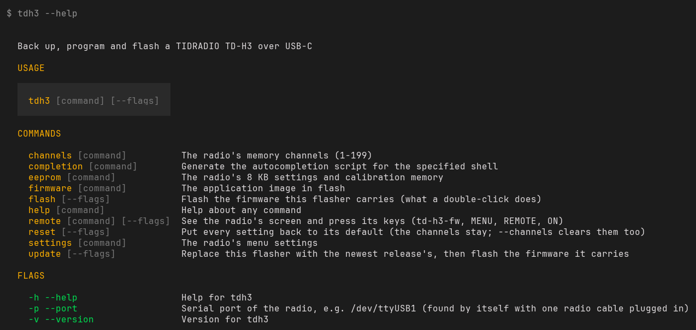
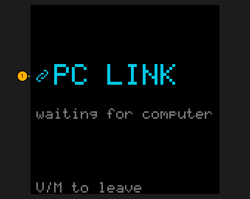
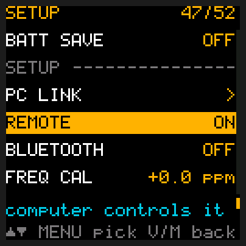
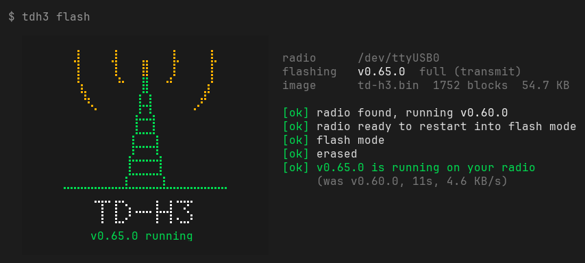
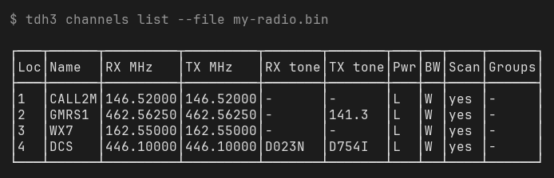
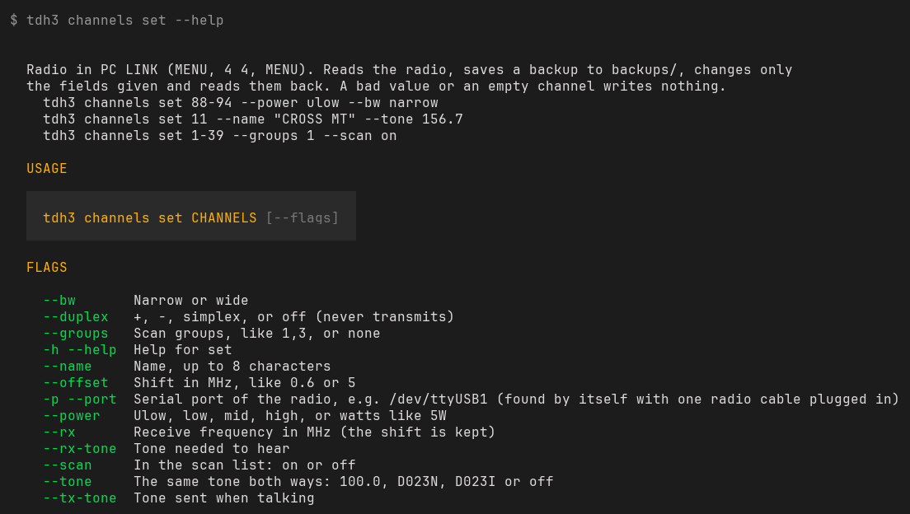
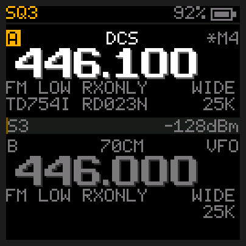

# The tdh3 program

`tdh3` is the flasher you downloaded. Besides putting firmware on the radio, it backs the radio up,
manages its channels and settings, and lets a computer see its screen and press its keys.

## Quick reference

| I want to… | Type | Radio needs |
|---|---|---|
| Put the firmware on the radio | `tdh3 flash` (or double-click the flasher) | Nothing: hold **PTT** when it asks |
| Get the newest version | `tdh3 update` | Internet, then hold **PTT** |
| See my channels | `tdh3 channels list` | PC LINK |
| Change channels | `tdh3 channels set 88-94 --power low` | PC LINK |
| Back up the radio | `tdh3 eeprom backup my-radio.bin` | PC LINK |
| See what the radio shows | `tdh3 remote screen` | REMOTE on |
| Let an AI assistant use it | Paste the [prompt below](#using-it-with-an-ai-assistant) | REMOTE on |

## Getting ready

**Running it.** Open a terminal in the folder where the flasher is. The examples here say `tdh3`:
type `.\tdh3.exe` on Windows and `./tdh3` on a Mac or Linux. See [Updating the firmware](Updating).

**Two ways the radio talks to a computer.** Each command needs one of these:

- **PC LINK**: press **MENU**, type **4** **6** (PC LINK), press **MENU**. The screen says
  *waiting for computer*. **V/M** leaves it when you're done. The radio doesn't receive while it's in PC LINK.
- **REMOTE**: press **MENU**, type **4** **7** (REMOTE), press **MENU**, set it to **ON**, press
  **MENU**. It stays on, and the radio works normally. It can never make the radio transmit.

**Several radios plugged in?** Add `-p` and the port, like `-p /dev/ttyUSB1` or `-p COM5`. With one
cable, `tdh3` finds it by itself.

**Every command explains itself.** `tdh3 --help` lists them, and `tdh3 channels set --help` shows
every option of one command.



PC LINK looks like this on the radio, and REMOTE like this once it's on:

 

## Firmware

| Command | What it does | Radio needs |
|---|---|---|
| `tdh3 flash` | Puts on the firmware this flasher carries. `--rx` for the receive-only build. | Hold **PTT** when it asks |
| `tdh3 update` | Downloads the newest flasher, checks its signature, replaces itself, then flashes. `--no-flash` stops before the flash. | Internet |
| `tdh3 firmware flash FILE.bin` | Flashes a firmware file you have. | Hold **PTT** when it asks |
| `tdh3 firmware extract FOLDER` | Saves the firmware this flasher carries as `.bin` files in that folder, the full build and the receive-only one. Leave out the folder to use the current one. | Nothing |



More: [Updating the firmware](Updating).

## Backups and settings

| Command | What it does | Radio needs |
|---|---|---|
| `tdh3 eeprom backup FILE.bin` | Saves the radio's whole memory: channels, settings and calibration. It only reads. | PC LINK |
| `tdh3 settings restore FILE.bin` | Puts the settings from a backup back. The channels and calibration on the radio stay. | PC LINK |
| `tdh3 reset` | Every setting back to its default. The channels stay; `--channels` empties them too. | PC LINK |

More: [Saving and restoring your settings](Updating#saving-and-restoring-your-settings),
[Putting the settings back to defaults](Updating#putting-the-settings-back-to-defaults).

## Channels

| Command | What it does | Radio needs |
|---|---|---|
| `tdh3 channels list` | Shows your channels. `--slots 1-20` for some; `--file FILE.bin` reads a backup instead. | PC LINK, or `--file` |
| `tdh3 channels export FILE.csv` | Saves them as a CHIRP CSV you can edit. | PC LINK, or `--file` |
| `tdh3 channels import FILE.csv` | Loads a CHIRP CSV. `--dry-run` only shows what it would do; `--clear` empties channels not in the file. | PC LINK |
| `tdh3 channels set CHANNELS` | Changes only what you give: `--name`, `--power`, `--bw`, `--rx`, `--duplex`, `--offset`, `--tone`, `--rx-tone`, `--tx-tone`, `--groups`, `--scan`. | PC LINK |
| `tdh3 channels move FROM TO` | Moves a channel to an empty number. | PC LINK |
| `tdh3 channels clear CHANNELS` | Empties channels. | PC LINK |
| `tdh3 channels lock CHANNELS` | Stops channels ever transmitting. `unlock` makes them simplex again. | PC LINK |
| `tdh3 channels copy FILE.bin` | Copies the whole channel list from another radio's backup. | PC LINK |

`CHANNELS` can be a list and ranges, like `1-39,41,88-94`. More:
[Changing channels from the computer](Channels-and-Scanning#changing-channels-from-the-computer).





## Remote control

All of these need REMOTE on.

| Command | What it does |
|---|---|
| `tdh3 remote screen` | Prints what the radio shows, as text. `-o shot.png` saves a picture. |
| `tdh3 remote tune 146.520` | Puts the selected slot on a frequency. |
| `tdh3 remote channel 11` | Puts the selected slot on a memory channel. |
| `tdh3 remote slot A` | Selects slot A or B. |
| `tdh3 remote keys 1 4 6` | Presses keys: `0`-`9`, `MENU`, `UP`, `DOWN`, `VM`, `*`, `#`, `TORCH`. Add `:long` to hold one. |
| `tdh3 remote home` | Goes back to the home screen. |
| `tdh3 remote settings` | Lists every menu setting and its value. It only reads. |
| `tdh3 remote watch` | Prints the signal and whether the squelch is open, five times a second. |
| `tdh3 remote wait "squelch open"` | Waits until that text shows on the screen. `--gone` waits for it to go; `--timeout 30m` gives up. |
| `tdh3 remote record FILE` | Saves everything the screen shows until **Ctrl-C**. |
| `tdh3 remote replay FILE` | Plays a recording back. `-o my.gif` makes an animated GIF. |

`tdh3 remote screen -o shot.png` saves a picture of the radio's screen, like this one:



More: [Recording the screen](Tools#recording-the-screen).

## Using it with an AI assistant

An assistant that can run commands on your computer (Claude Code, Codex and others) can work the
radio with `tdh3`. Switch REMOTE on, then paste this into the chat.

```text
You can operate my TIDRADIO TD-H3 radio, which runs td-h3-fw, with the command-line
program ./tdh3 (called tdh3 below; on Windows it's .\\tdh3.exe). It's connected by USB-C. For exact
options run: tdh3 --help, and tdh3 COMMAND --help.

How the radio connects:
- REMOTE must be on for every `tdh3 remote` command.
- PC LINK is needed for `tdh3 channels`, `eeprom`, `settings` and `reset`. To enter it run
  `tdh3 remote keys MENU 4 5 MENU`, wait a few seconds, and try again if the radio doesn't
  answer at first. While it's in PC LINK, `tdh3 remote` won't answer. Ask me to press V/M
  on the radio to leave it.

Working the radio:
- After every step, read the result with `tdh3 remote screen`. Never assume a key worked.
- Use `tdh3 remote wait "TEXT"` to wait for something rather than guessing a delay.
- Go to menu items by number, never by scrolling: `tdh3 remote keys MENU 1 1` opens item 11.
- In a menu item: MENU selects it, UP or DOWN changes the value, MENU confirms. Then press
  V/M ONCE to leave the menu. A second V/M switches the slot between frequency and memory mode.
- `tdh3 remote settings` walks the whole menu and is slow. Use it only when you need every
  setting; to read one value, open that item by number and read the screen.

Safety:
- The radio refuses to transmit from the computer. Don't try to work around that.
- Only with my say-so: `tdh3 flash`, `tdh3 update`, `tdh3 reset`, `tdh3 settings restore`,
  `tdh3 channels clear`, `import`, `copy` or `lock`, and changing TX BANDS (item 13).
  A flash also needs me to hold PTT.
- `tdh3 channels` commands that change the radio save a backup in backups/ first. Before anything
  else that writes to it, run `tdh3 eeprom backup FILE.bin`.
- Leave the radio as you found it: on the home screen, same channel, same settings.
```

To keep it as a Claude Code skill, save it as `~/.claude/skills/td-h3-radio/SKILL.md` with these
lines at the very top:

```text
---
name: td-h3-radio
description: Operate a TD-H3 radio running td-h3-fw with the tdh3 command-line program.
---
```

More on what an assistant can do, and practising without a radio:
[AI agents guide](https://github.com/limehawk/td-h3-fw/blob/main/docs/AI-AGENTS.md).
