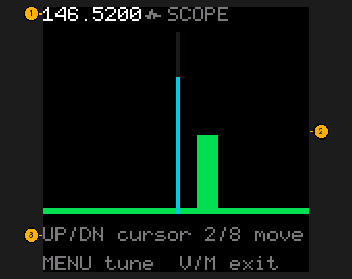
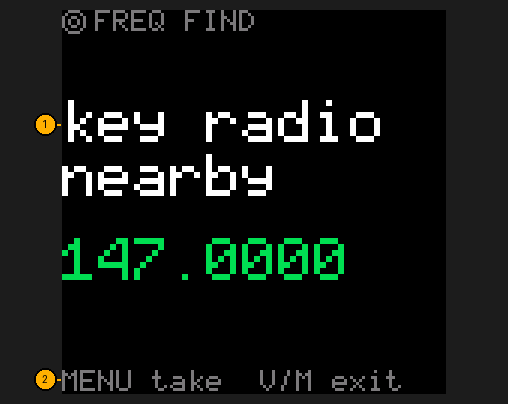
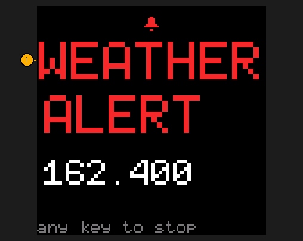
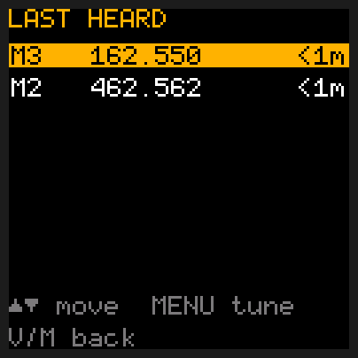
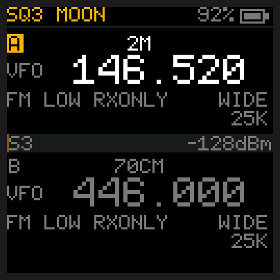
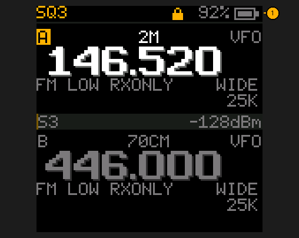
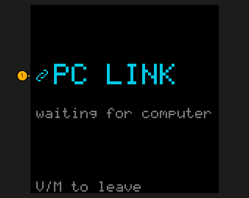
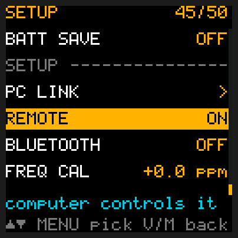

# Tools

## Quick reference

| I want to… | Press |
|---|---|
| See the band around me (scope) | Hold **3**; **MENU** tunes to the cursor, **V/M** leaves |
| Find a nearby radio's frequency (freq find) | Hold **7**; **MENU** takes it, **V/M** leaves |
| See who was on lately | **MENU**, **3** **1** (LAST HEARD), **MENU** |
| Watch for weather alerts | **MENU**, **4** **1** (WX ALERT), **MENU**, **UP** / **DOWN** to your channel, **MENU** |
| Stop the weather alarm | Any key |
| Flashlight on / off | Tap **side key 2** |
| Lock / unlock the keys | Hold **\*** (**PTT**, **side key 1** and the flashlight still work locked, unless KEY LOCK is KEYS+PTT) |
| Connect to a computer | **MENU**, **4** **4** (PC LINK), **MENU** |
| Record the screen on a computer, as a GIF | REMOTE on, then `tdh3 remote record my.rec` and `tdh3 remote replay my.rec -o my.gif` ([below](#recording-the-screen)) |

## Scope (hold 3)

A live picture of the band around your frequency: each bar is one channel, taller = stronger.

1. **The frequency under the cursor.**
2. **Bars**: green is the signal now, the amber tick above is the strongest seen (peak hold).
   The highlighted column is the cursor.
3. **Keys**: UP/DOWN move the cursor, 2/8 move the window a quarter down or up, 0 clears the
   peaks, MENU tunes the selected slot to the cursor (in frequency mode), V/M leaves.

The 64 bars are one tuning step apart (STEP kHz in the [Menu](Menu)), so the scope's width follows
the step: 64 x 25 kHz = 1.6 MHz. Holding **3** stops a scan.

## Freq find (hold 7)

Finds the frequency of a radio transmitting right next to yours: handy for programming a friend's
radio or finding a nearby transmitter.

1. **Found frequency**, rounded to the nearest 2.5 kHz. Key the other radio close by; it alternates between
   VHF and UHF every second until it hears something.
2. **MENU** takes the frequency into your slot, in frequency mode (only once it has found one);
   **V/M** leaves without it. Holding **7** stops a scan.

## Weather alert

MENU → WX ALERT → pick your NOAA channel. Every 5 seconds the radio checks it for the 1050 Hz
alert tone that comes before severe-weather warnings. It keeps checking with the squelch at 0 or
monitor on (as long as no station is coming in on your own channel), and while you listen to the
[FM radio](FM-Radio): there, hearing the tone closes the FM radio. If it hears it:

1. **WEATHER ALERT** and the channel, with a two-tone siren every second and a half, and both
   status lights blinking amber. Any key stops it and goes back to where you were.

In weather mode (hold **#**) the radio is already on the channel, so it listens for the tone all the
time instead of every 5 seconds, and the alarm sounds there too: once for each alert, so a key
silences it for good even while the tone goes on. AUTO OFF's sleep stops the checks.

## Last heard

MENU → LAST HEARD (item 31), MENU: the last 8 stations the radio heard, newest first
(`nothing heard yet` until it has heard one). Each row shows
the memory channel (`M12`) when it was one, the frequency, and how long ago (`<1m`, `14m`, `2h`).
UP/DOWN lights a row, MENU tunes the selected slot there, V/M goes back. The list is kept until you
switch the radio off.

Stopping a scan with **\*** between stations, after it found two or more, opens this list by itself (stopped while it's on a station, it stays there). The
stations that scan stopped on are the top rows, the newest lit; there **V/M** goes back to where the
scan started ([Scanning](Channels-and-Scanning#scanning)).

## Flashlight

All on **side key 2**, the way Olight's one-button flashlights work. It works even with the keypad
locked or the menu open:

- **Tap**: on or off. It comes back on at the brightness you last used.
- **Hold while it's off**: moonlight, a very dim glow that keeps your night vision.
- **Hold while it's on**: moonlight → low → medium → high → moonlight, one step a second. Let go at the one you want.
- **Double tap**: high, straight away.
- **Triple tap**: strobe.
- **Hold 5 seconds while it's off**: SOS in Morse.
- A tap stops strobe or SOS.

A tap waits about a third of a second to be sure it isn't the start of a double tap. The status
bar shows the level (`MOON`, `LOW`, `MED`, `HIGH`) or `STROBE` or `SOS` while it's on.

## Keypad lock

Hold **\*** to lock or unlock (two rising notes when it unlocks). Locked keys play the "not
possible" sound and do nothing else; **PTT**, **side key 1** and the flashlight on side key 2 still
work. Locking stops a scan.

To carry the radio in a pocket or bag without it transmitting by accident, set **MENU** → KEY LOCK
(item 39) to **KEYS+PTT**. Then the lock stops **PTT** and **side key 1** too: they show
**LOCKED: NO TX** and play the "not possible" sound. The flashlight still works. Hold **\*** to unlock
as usual.

1. **A padlock** in the status bar at the top. Red when KEY LOCK is KEYS+PTT: PTT is locked too.

## PC LINK

1. MENU → PC LINK → MENU hands the radio to a computer (CHIRP or `tdh3`). The receiver is off
   while it waits; **V/M** leaves. See [Channels and scanning](Channels-and-Scanning).

## Recording the screen

With the radio plugged into a computer, `tdh3` (the flasher you downloaded) can record what the
screen shows while you use the radio, and turn it into an animated picture to share or to show
someone how to do something.

1. Switch on REMOTE: **MENU**, **4** **5**, **MENU**, **UP** so it says **ON**, **MENU**, then
   **V/M** to leave the menu.

   

2. On the computer, type `tdh3 remote record my.rec`. It starts recording at once.
3. Use the radio as usual: press keys, change channels, let it receive. Every change on the screen
   is saved with the moment it happened.
4. Press **Ctrl-C** on the computer to stop. It says how many seconds it saved.
5. `tdh3 remote replay my.rec` plays it back as text, at the speed it happened (add `--fast` to
   see it all at once). `tdh3 remote replay my.rec --fast -o my.gif` also makes an animated GIF
   that plays at the same speed as the real screen.

Recording never presses a key and never transmits. While it records, the computer asks the radio
for its status once a second, so the recording also has the frequency, signal and battery.
