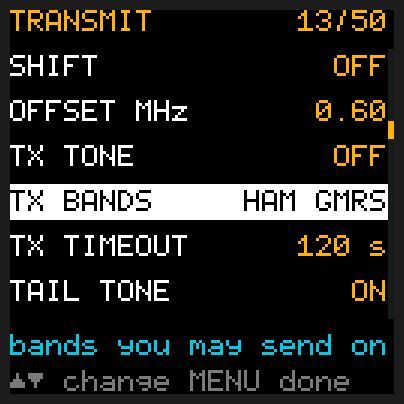
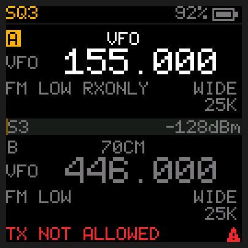
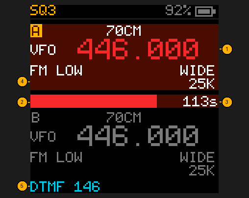
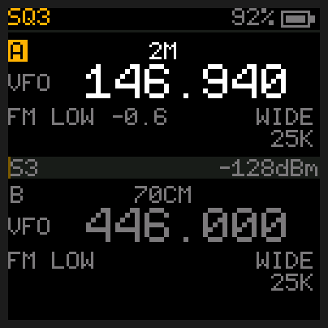
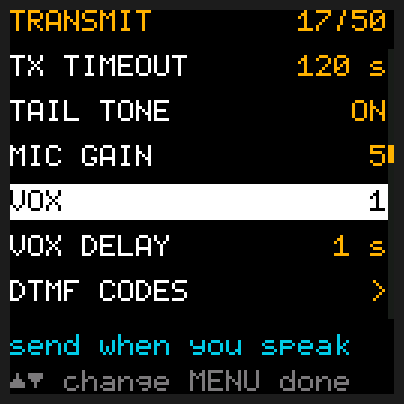
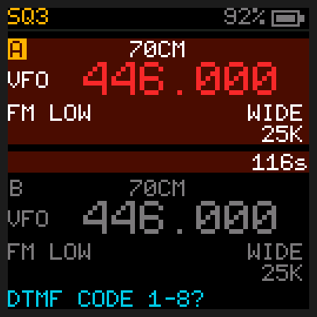
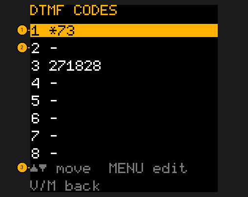

# Transmitting

## Quick reference

| I want to… | Press |
|---|---|
| Talk on slot A (top) | Hold **PTT**, speak, let go to listen |
| Talk on slot B (bottom) | Hold **side key 1** (the small one) |
| Send touch-tones (DTMF) | Keep holding **PTT** and press the digits, **\*** or **#** |
| Send a stored DTMF code | Keep holding **PTT**, press **MENU**, then the code's number **1**-**8** |
| Talk without pressing PTT (VOX) | **MENU**, **1** **7** (VOX), **MENU**, **UP** to a level, **MENU** |
| Store DTMF codes | **MENU**, **1** **9** (DTMF CODES), **MENU** |
| Choose where I may transmit | **MENU**, **1** **3** (TX BANDS), **MENU**, **UP** / **DOWN**, **MENU** |
| Change power | Hold **2**: low → mid → high → ultra-low. On a memory channel it's saved with the channel. In frequency mode **MENU**, **0** **9** (POWER) does it too |
| Set the longest transmission | **MENU**, **1** **4** (TX TIMEOUT; 120 s to start with) |
| Check which build I have | **MENU**, **5** **0** (VERSION) |

**You need a licence to transmit**, and following the rules for each service is up to you, as on any
radio. In the US: an amateur (ham) licence for the 2 m and 70 cm bands, a GMRS licence (no exam,
covers your family) for GMRS. MURS and FRS need no licence, but the rules expect radios certified for
them, with low power (MURS 2 W, FRS 2 W, FRS channels 8-14 0.5 W: use ULTRA LOW). Listening needs no
licence.

The **receive-only build** (`td-h3-rx.bin`) can never transmit. The **full build** (`td-h3.bin`)
transmits only on the services switched on in **MENU → TX BANDS** (HAM and GMRS to start with):

| Service | Frequencies |
|---|---|
| HAM | 144.000-148.000 MHz (2 m) and 420.000-450.000 MHz (70 cm) |
| GMRS | 462.550-462.725 MHz, and the 467.550-467.725 MHz repeater inputs |
| MURS | 151.820, 151.880, 151.940, 154.570, 154.600 MHz |
| FRS | 462.550-462.725 MHz, and 467.5625-467.7125 MHz (channels 8-14) |

To change them: **MENU**, type **1** **3** (TX BANDS), **MENU**, then **UP** or **DOWN** steps through every
mix of the four, shown as `HAM GMRS` (or `H G M F` with three or four on). **NONE** turns transmit
off everywhere. **MENU** when it's right. Aircraft, marine, police and other government frequencies are never allowed.

Anywhere else PTT shows **TX NOT ALLOWED**, and the home screen shows **RXONLY** on that slot
(when it has no repeater shift). AM and USB never transmit either: PTT shows **TX NOT ALLOWED**. A full build on a radio
without its factory calibration says **TX NOT ALLOWED** everywhere. Other refusals you might see:

- **TX LOCKED CHANNEL**: the channel is marked receive-only (CHIRP Duplex `off`, or `TXLOCK` in
  the CSV comment). Weather, marine and aircraft channels are usually set this way.
- **BUSY: NO TX**: the channel has busy lockout on (set in CHIRP, `BCL`) and the channel is busy. Any
  signal counts, even one with a different tone that you can't hear. Frequency mode has no busy lockout.
- **BATTERY LOW: NO TX**: under 6.5 V. Charge it.
- **LOCKED: NO TX**: the keypad is locked and KEY LOCK is set to KEYS+PTT. Hold **\*** to unlock.

- **PTT HELD: LET GO**: PTT (or side key 1) was already down when you switched the radio on, the
  way you hold it to update the firmware. It stays, and the radio won't transmit, until you let go; then press
  again to talk.

These messages come with the "not possible" sound and go away by themselves after 3 seconds, or as soon
as you press a key; **PTT HELD: LET GO** is silent and stays until you let go.

PTT does nothing while the menu, a list or the save question is open: press **V/M** to close it first.
In the FM radio, PTT and side key 1 leave it and transmit.

1. **The frequency turns red** while you transmit (the transmit frequency, including any
   repeater offset).
2. **Mic level bar**, across the screen, on the same dark red as the slot: how loud you're coming in. Aim for it moving well into the
   bar when you speak.
3. **Seconds left** before the TX timeout (or seconds talked, with the timeout off). Red in the last
   10 seconds, with a warning beep.
4. **The slot turns dark red** the whole time you transmit (the slot you're transmitting on, with the
   status light on its side red), so you can see it from across the room.
5. **Touch-tones sent** while you hold PTT (here 1, 4, 6): see below.

On a repeater, the home screen shows which way you'll transmit before you press anything. Here
SHIFT is on AUTO and 146.940 is a repeater's frequency, so `-0.6` says you'll transmit 0.6 MHz below it.

**PTT** transmits on slot A; **side key 1** (the small one) transmits on slot B. The slot you
transmit on becomes the selected one, and stays selected after you let go (reverse goes off, and
weather mode ends, when that moves you to the other slot). In dual watch, PTT answers whichever
slot you just heard. The keypad lock stops neither key, unless KEY LOCK is set to KEYS+PTT.

Transmit power comes from your radio's own factory calibration, so it matches what TIDRADIO set
at the factory. Without that calibration the radio won't transmit at all. TIDRADIO calibrated LOW
and HIGH; MID is set between the two for each band, from those same factory settings. ULTRA LOW is
the least the radio can send, for talking across a room or a campsite.

Measured on one radio into a dummy load with a power meter (battery about 7.5 V); yours will be
close, not identical:

| Power | 2 m (146.520 MHz) | 70 cm (446.000 MHz) | GMRS (462.5625 MHz) |
|---|---|---|---|
| ULTRA LOW | 0.47 W | 0.48 W | 0.24 W |
| LOW | 1.9 W | 1.6 W | 1.4 W |
| MID | 3.2 W | 3.2 W | 3.0 W |
| HIGH | 5.2 W | 4.9 W | 4.2 W |

## VOX: talk without pressing PTT

With VOX on, the radio transmits when it hears your voice on its microphone, and goes back to
listening once you've been quiet for VOX DELAY. Handy when your hands are busy. Set it in the
[Menu](Menu): VOX (item 17) from 1, which needs a loud voice close to the radio, to 9, which picks
up a quiet one (and more wind and noise); VOX DELAY (item 18) for how long it waits after you stop.
`VOX` shows in the status bar while it's on.

So it can't transmit by surprise, VOX keys up only:

- from the home screen: not in the menu or a list, not while scanning, in weather mode or after an alert;
- when nothing is being heard on the channel: it never talks over a station, and the speaker can't key it;
- where PTT would: TX BANDS, a receive-only channel, busy lockout, a low battery and KEY LOCK KEYS+PTT
  all stop it the same way (the message shows, without the sound; with the keypad locked under
  KEY LOCK KEYS+PTT, VOX just doesn't key, with no message);
- and TX TIMEOUT still cuts it off. After a timeout or a refusal it waits until you've been quiet for
  VOX DELAY before it tries again.

PTT works as usual with VOX on. Wind, a noisy room or the radio rubbing in a pocket can key it: turn
VOX OFF, or lower the level, when you don't need it.

## Touch-tones (DTMF)

Repeaters, links and nets use touch-tones (see DTMF in the [Glossary](Glossary)) for codes: to
connect to a node, switch something on, or open an autopatch. To send them:

1. Hold **PTT** (or side key 1) and keep holding it.
2. Press the digits, **\*** or **#**, the way you'd dial a phone. Each tone lasts as long as you hold
   its key. The bottom line shows what you've sent: `DTMF 146#`.
3. Let go of PTT when you're done.

### Stored codes

The radio keeps 8 codes of up to 7 digits, for the ones you send often. To send one, hold **PTT**,
press **MENU** (the bottom line says `DTMF CODE 1-8?`), then the code's number, **1** to **8**. Its
digits go out by themselves. An empty code sends nothing.

To store them: **MENU**, **1** **9** (DTMF CODES), **MENU**.

1. **Code 1**, `*73`. **UP** / **DOWN** pick a code.
2. **An empty code** shows `-`.
3. **MENU** to edit the picked code: the digits, **\*** and **#** go after its old ones (7 at
   most), and **V/M** takes the last one off, so press it until the code is empty to type a new
   one. **MENU** saves it (two rising notes). With every digit taken off, **V/M** once more puts
   the code back as it was; **V/M** again goes back to the menu.

CHIRP can set the same 8 codes (Settings, DTMF, "1" to "8"). CHIRP shows a stored **\*** as `E` and
**#** as `F`, and can't type them itself: enter codes with **\*** or **#** on the radio.
