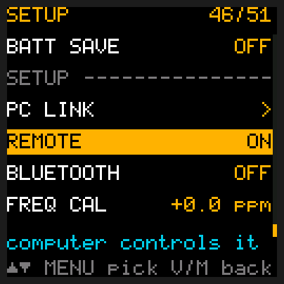
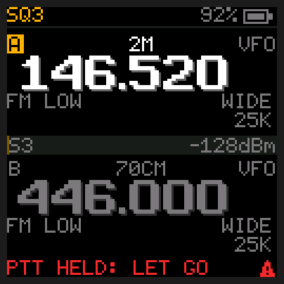
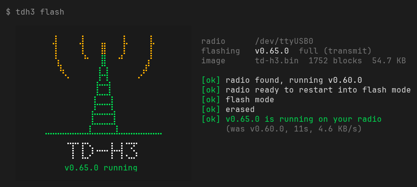
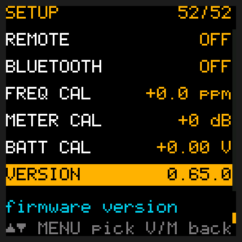
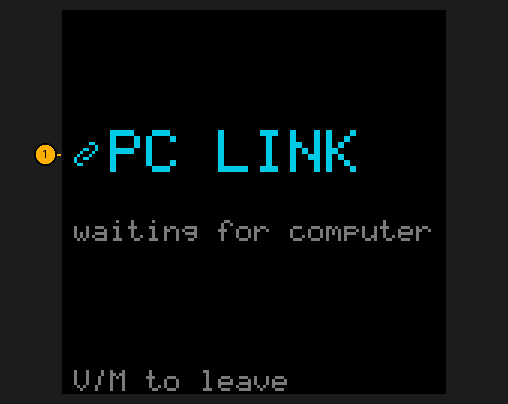

# Updating the firmware

## Quick reference

| I want to… | Do |
|---|---|
| Get the flasher | Download the one for your computer from the newest release: the firmware is inside it ([below](#get-the-flasher)) |
| Flash the first time (radio still on TIDRADIO's firmware) | Open the flasher, then switch the radio off, hold **PTT** and switch it on, let go after 2 s |
| Update to the newest release | `tdh3 update`: fetches the newest flasher, checks it, then flashes ([below](#updating-with-tdh3-update)) |
| Flash new firmware | Radio on with REMOTE on: open the flasher, then press and hold **PTT** when it says so; let go at **flash mode** |
| Flash with the radio off (or REMOTE off) | `tdh3 flash`, then switch the radio off, hold **PTT** and switch it on, let go after 2 s |
| Flash the receive-only build | `tdh3 flash --rx` |
| Flash some other image | `tdh3 firmware flash FILE` |
| See the version before flashing | Set **MENU**, **4** **6** (REMOTE) to ON and leave the radio on |
| The flasher keeps saying **plug the radio's USB-C cable into the computer** | Check the cable carries data; on a TD-H3 Plus it never finds one: this firmware is for the TD-H3 only |
| Flash with two radios plugged in | The flasher lists them, numbered: type the number of the one to flash |
| `no answer from flash mode` | Switch off, hold **PTT**, switch on again |
| Check the version afterwards | **MENU**, **5** **1** (VERSION) |
| Back up the radio first | **MENU**, **4** **5** (PC LINK), **MENU**, then `tdh3 eeprom backup my-radio-backup.bin` |
| Put every setting back to its default | **MENU**, **4** **5** (PC LINK), **MENU**, then `tdh3 reset` ([below](#putting-the-settings-back-to-defaults)) |
| Put my settings back from a backup | **MENU**, **4** **5** (PC LINK), **MENU**, then `tdh3 settings restore my-radio-backup.bin` ([below](#saving-and-restoring-your-settings)) |
| Copy channels from another radio | [Channels and scanning](Channels-and-Scanning#copy-channels-from-another-radio): `tdh3 channels copy FILE` |
| Get just the `.bin` files | `tdh3 firmware extract my-folder` saves both builds there |
| Go back to TIDRADIO's firmware | `tdh3 firmware flash H3_250317.BIN` ([below](#going-back-to-tidradios-firmware)) |
| `refusing v0.55.2-3: not a release` | That build isn't a numbered release: flash a release, or add `--force` for a test build |

Your channels and settings are kept: flashing only replaces the program, never the memory that
holds your list. (Coming from a version before 0.50.0, the menu settings go back to their defaults
once, with slots A and B on your first two channels; the channels stay.) The bootloader that does the flashing can't be overwritten, so a bad flash is
always recoverable by flashing again.

## Get the flasher

Download the flasher for your computer. It's the only file you need: each release's flasher
carries that release's firmware.

| Computer | Download |
|---|---|
| Windows | [tdh3.exe](https://github.com/limehawk/td-h3-fw/releases/latest/download/tdh3.exe) |
| Mac with an Apple chip (M1 or newer) | [tdh3-macos-apple.zip](https://github.com/limehawk/td-h3-fw/releases/latest/download/tdh3-macos-apple.zip) (double-click it to unzip) |
| Mac with an Intel chip | [tdh3-macos-intel.zip](https://github.com/limehawk/td-h3-fw/releases/latest/download/tdh3-macos-intel.zip) (double-click it to unzip) |
| Linux (most PCs) | [tdh3-linux-x64.tar.gz](https://github.com/limehawk/td-h3-fw/releases/latest/download/tdh3-linux-x64.tar.gz) |
| Raspberry Pi (64-bit Raspberry Pi OS) | [tdh3-linux-arm64.tar.gz](https://github.com/limehawk/td-h3-fw/releases/latest/download/tdh3-linux-arm64.tar.gz) |

The first time you open it, your computer may stop it, because it's a program from the internet
that isn't signed by Microsoft or Apple:

- **Windows**: if Edge stops the download ("isn't commonly downloaded"), click **...**, **Keep**,
  **Show more**, **Keep anyway**. When you open it, Windows may say it protected your PC: click
  **More info**, then **Run anyway**. (With Smart App Control on, Windows blocks programs that
  aren't signed and offers no way past; use another computer.)
- **Mac**: Safari may have unzipped it already. The first time, the Mac says it can't check the
  flasher: go to **System Settings**, **Privacy & Security**, scroll down and click **Open
  Anyway**, confirm with your password, and open the flasher again. It opens in Terminal.
- **Linux** unpacks in a terminal in its folder (`cd ~/Downloads`): `tar xf tdh3-linux-*.tar.gz`,
  then `./tdh3`. If it says **permission
  denied** for the cable, run `sudo usermod -aG dialout $USER` once (`uucp` on Arch), then log out
  and back in. If it never finds the cable on Ubuntu, the braille-display service has taken it:
  `sudo apt remove brltty`.

Windows and recent Macs know the radio's USB cable by themselves; on an older Windows, if no radio
is found, install the CH340 driver from the cable chip's maker (WCH).

In a terminal, type `.\tdh3.exe` on Windows and `./tdh3` on a Mac or Linux where these pages say
`tdh3`. Opening the flasher (a double-click)
and typing `tdh3 flash` do the same thing.

## Flash

1. Connect the radio's USB-C port to the computer.

   **The first time**, while the radio still has TIDRADIO's firmware, it doesn't matter whether
   the radio is on: in step 3 you'll switch it off and on with **PTT** held.

   **Once it has this firmware**, leave the radio on, with MENU → REMOTE (item 46) on: the flasher
   can then tell you which version it runs now, and you won't need to switch the radio off and on
   to flash it.

   

2. Open the flasher: double-click it (or type `tdh3 flash` in a terminal). It finds the radio's
   cable by itself and puts on the firmware it carries, the full build that can transmit
   (`tdh3 flash --rx` puts on the receive-only one), whatever other `.bin` files are in the folder;
   `tdh3 firmware flash FILE` puts on any other image. It draws the radio
   tower (the same one the radio shows when it starts), says which cable, which version it's about
   to put on and what the radio runs now, beside the tower:

   ```
   radio      /dev/ttyUSB0
   flashing   v0.60.0  full (transmit)
   image      td-h3-fw-0.60.0.bin (built in)  1665 blocks  52.0 KB

   [ok] radio found, running v0.59.7
   ```

   With TIDRADIO's firmware on the radio (or REMOTE off) the fourth line says **radio not
   answering (off, or REMOTE off): you'll switch it on holding PTT next** instead: that's normal.
   An older flasher says the same to a radio with newer firmware, which talks over the cable
   faster than it knows; it still flashes, the switch-on-holding-PTT way.

   It flashes only numbered releases (`0.55.2`) and TIDRADIO's own images. A build made between
   releases (`0.55.2-3`, or one with a `+`) is refused before anything is shown, with
   `refusing ...: not a release`; `tdh3 flash --force` flashes it anyway, for testing.

   With two or more radio cables plugged in, it first lists them, numbered, with what each radio
   says (**running v0.59.7**, **in flash mode** or **not answering**), and you type the number of
   the one to flash. Not sure which is which? Unplug the others and start again.

   Nothing on the radio changes until you hold PTT in the next step, so there's nothing to confirm
   here. (In a script, `tdh3 flash --yes` waits for the radio as long as it takes; it can't ask which
   radio, so with several cables give it one with `-p`, as in `tdh3 -p /dev/ttyUSB1 flash`;
   `-p COM4` on Windows.)
3. **Press and hold PTT when the flasher says so.** With REMOTE on, the flasher gets the radio
   ready and says **press and hold PTT now**, and waits as long as you need. Press **PTT** (the big
   key on the side you talk with) and keep holding it. The radio restarts and its screen goes dark:
   it is in flash mode, ready for the new firmware. It doesn't transmit. Let go once the flasher
   says **flash mode**. Side key 1 (the small side key) works the same way.

   If the radio was off, had REMOTE off or still has TIDRADIO's firmware, the flasher asks for the
   old way instead: **switch the radio off, then hold PTT and switch it on.** Keep holding about 2 seconds, then let go. Either side
   key works instead of PTT, on any TD-H3, stock firmware too; one key is enough.
   The screen stays dark; that's normal. If the radio starts up as usual instead (the tower and
   the home screen), it missed flash mode: let go of PTT and try again.
   With this firmware it won't transmit while you hold PTT from switching on; the bottom line
   says **PTT HELD: LET GO**.

   

4. The tower in the flasher's window acts out each step (the radio's own screen stays dark): waves out of the tip while it listens for
   the radio, a dim band wiping down the mast while the radio erases, then the mast filling amber
   from the ground up as the new firmware goes on (about 10 seconds; the percent and time left are
   beside it). When it's all on, the tower turns green and a last wave goes out. The radio restarts
   into the new firmware, and once it answers the screen says it's running:

   

   **Ctrl-C** stops it at any step. Before the radio starts erasing nothing on it has changed;
   after that it stays in flash mode with its screen dark, so run `tdh3 flash` again.

   Opened with a double-click, the window waits for **Enter** before it closes, so you can read
   how it went. It all stays in the window you started it in: nothing scrolls. In a window too small for it,
   or piped into a file, it prints plain lines with a bar instead.

If the radio was already in flash mode when you started (left there by an earlier try), the flasher
says **radio found, in flash mode** and goes straight on. If the radio stops answering in flash
mode for 10 seconds, the flasher says **no answer from flash mode**: switch the radio off, hold
PTT and switch it on (the old way in step 3), and it carries on by itself:

```
  [ok] radio found, in flash mode
  [!!] no answer from flash mode
  [ok] flash mode
  [ok] erased
```

If the last line is amber instead of green, the flash went through but the radio didn't
answer over the cable (REMOTE off): check MENU → VERSION (item 51) yourself.



Unplug the USB cable when you're done listening: plugged into a computer it puts noise on the
receiver and weak stations cut out.

## Updating with `tdh3 update`

Once you have the flasher, it can fetch the next release by itself, so you don't have to download
it again. It needs the internet.

1. Plug the radio in and leave it on with REMOTE on, as in [Flash](#flash), step 1.
2. In a terminal in the flasher's folder, type `tdh3 update` (`.\tdh3.exe update` on
   Windows, `./tdh3 update` on a Mac or Linux).
3. It asks GitHub which release is the newest. If your flasher is that release, it says
   **up to date** and stops: there's nothing to do.
4. Otherwise it downloads the newest flasher for your computer and checks it. Every release is
   signed, and the flasher checks that signature and the download's checksum before it changes
   anything: a download that is damaged or was changed by someone else is refused, and your
   flasher stays as it was.
5. The new flasher takes the old one's place, under the same name, and flashes the firmware it
   carries. From here it's [Flash](#flash), step 3: press and hold **PTT** when it says so.

`tdh3 update --no-flash` only replaces the flasher; flash later with `tdh3 flash`. With several
radio cables, `-p` picks one, as for flashing: `tdh3 -p COM4 update`.

What it may say:

- **up to date**: you have the newest release.
- **built from source**: a flasher you built yourself never counts as up to date, so it fetches
  the newest release's.
- **isn't signed** or **doesn't match its checksum**: the download wasn't the release's own file.
  Nothing was changed; try again later, or download the flasher as in [Get the flasher](#get-the-flasher).
- **can't replace**: the flasher is in a folder you can't write to. Move it to a folder of your own
  (your Downloads folder) and run it from there, or download the new one yourself.
- **Unknown command "update"**: your flasher is older than this command. Download the new one once,
  as in [Get the flasher](#get-the-flasher).

On Windows the old flasher stays beside the new one as `tdh3.old.exe` until you next open the
flasher, which deletes it.

If `tdh3 update` says the release **has no** file for your computer, your flasher is from v0.63 or v0.64, before the downloads were renamed. [Download the new flasher](#get-the-flasher) by hand this once; after that `tdh3 update` works again.

## Putting the settings back to defaults

`tdh3 reset` puts every menu setting back the way it was when the firmware was new, with slots
A and B on your first two channels. Your memory channels and FM radio presets stay. The radio's factory
transmit calibration is never touched. Flashing doesn't do this: it keeps your settings.

1. Switch the radio on and plug it into the computer with its USB-C cable.
2. On the radio: press **MENU**, type **4** **5** (PC LINK), press **MENU**. The screen says
   *waiting for computer*.

   

3. On the computer, in a terminal in the flasher's folder:
   ```bash
   tdh3 reset
   ```
   It shows what it will reset and what it keeps, then waits. Press **Enter**.
4. The radio restarts by itself and comes back on its home screen with every setting at its
   default. The last line on the computer says *the radio restarted with every default*.

If it says *the radio didn't answer*, the radio isn't in PC LINK: do step 2 again and rerun.
If it says *switch the radio off and on now, without pressing V/M*, the radio has older firmware
that doesn't restart by itself: switch it off and on, without pressing **V/M** first (V/M would
save the old settings back).

To empty the channel list too, so the radio starts completely fresh: `tdh3 reset --channels`.

## Saving and restoring your settings

A backup holds every menu setting, so you can try things and put your own setup back in one go,
or copy your settings onto a second TD-H3.

1. **Save them.** Radio in PC LINK (**MENU**, **4** **5**, **MENU**), then:
   ```bash
   tdh3 eeprom backup my-radio-backup.bin
   ```
   Press **V/M** on the radio when it's done.
2. **Put them back, any time later.** Radio in PC LINK again, then:
   ```bash
   tdh3 settings restore my-radio-backup.bin
   ```
   It shows what it will do, then waits. Press **Enter**. The radio restarts by itself with the
   settings from the backup. The last line on the computer says *the radio restarted with them*.

Only the settings come back: the memory channels on the radio stay as they are, and the radio's
own factory calibration is never written, even when the backup comes from another radio. To copy
channels from a backup, use `tdh3 channels copy`. The messages and what to do about them are the
same as for `tdh3 reset` above.

## Going back to TIDRADIO's firmware

Download the TD-H3 firmware from TIDRADIO's firmware page,
https://tidradio.com/pages/tidradio-firmware, and unzip it: it holds `H3_250317.BIN`. Put that file
beside the flasher, open a terminal there, and run:

```bash
tdh3 firmware flash H3_250317.BIN
```

It starts as soon as it finds the radio, and asks you to switch the
radio off and on holding **PTT** as in step 3. It ends on an amber line (**the radio didn't
answer**): that's normal, because TIDRADIO's firmware doesn't talk back over the cable.

**Back up first** (**MENU**, **4** **5** (PC LINK), **MENU**, then):
```bash
tdh3 eeprom backup my-radio-backup.bin
```
This only reads: it never writes to the radio.
